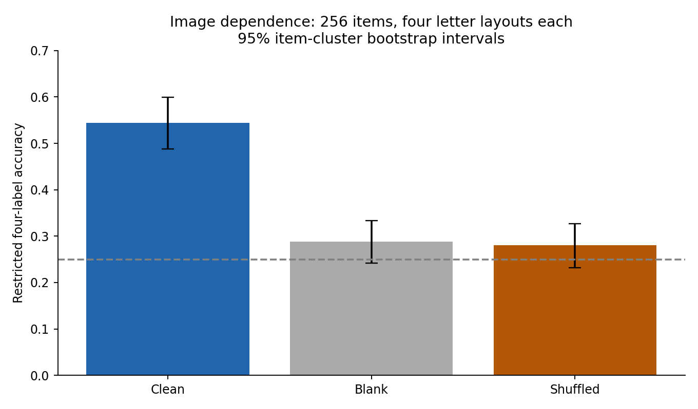
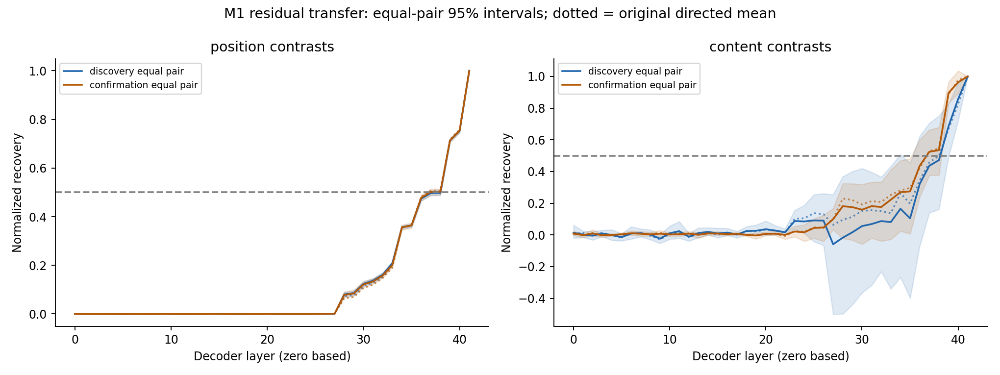
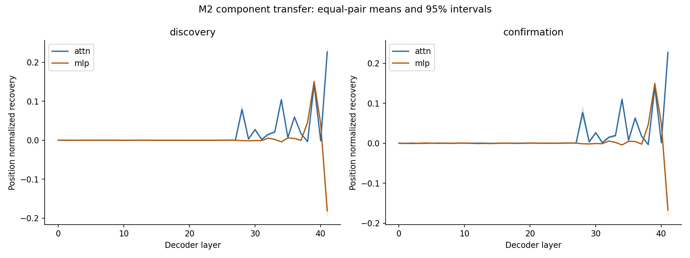
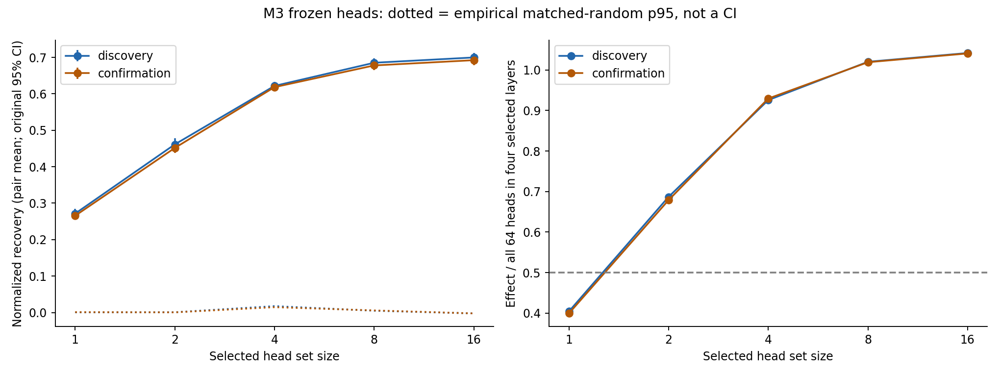
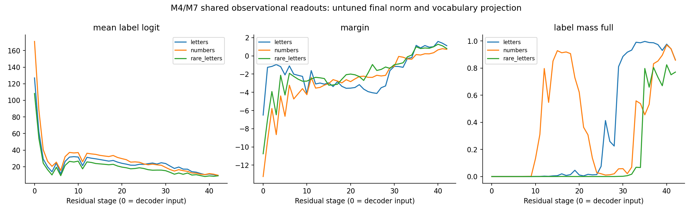
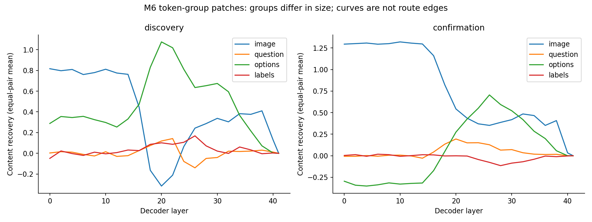
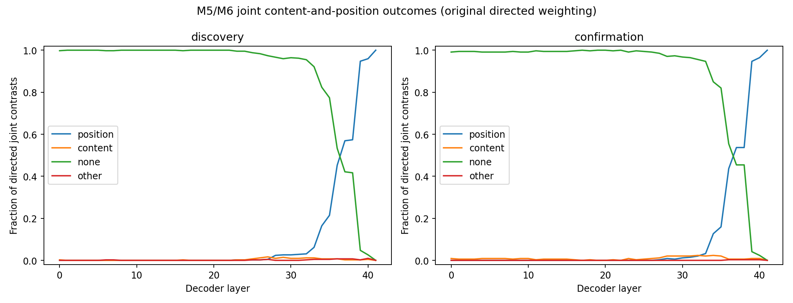
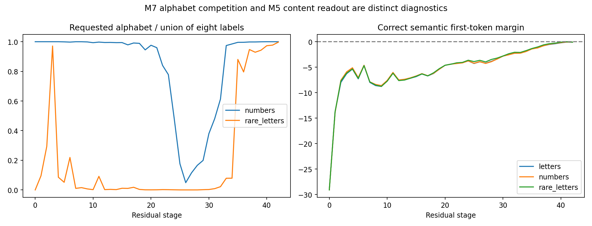

# PaliGemma2-10B Core-7: detailed saved-evidence analysis

**Analysis identity:** PALI-CORE7-ANALYSIS-20261029. **Prepared:** 29 October 2026.
**Campaign:** `run_20261026T114918_068380Z`; launch `launch_20261026T114219_401864Z`.
**Model:** `google/paligemma2-10b-mix-448`, revision `b26d16fb4251090ba4a4aa5af9fca1f8248ed5b6`.
**Scope:** local analysis of saved records. No inference, training, model rerun, campaign repair, or change to the historical three-model synthesis.

## 1. Main findings and the status of this evidence

PaliGemma provides evidence for **late, attention-dominated answer transfer and a small reproducible set of causally effective attention heads** on this controlled CLEVR multiple-choice task. It does **not** provide a clean replication of the stronger claim that position transfer consistently precedes semantic-content transfer. That ordering changes from position-first in discovery to a same-layer threshold crossing on confirmation under the original weighting. Under the additional equal-pair weighting, discovery also becomes same-layer. This sensitivity, and unstable semantic-content normalization, make a rigid position-before-content processing sequence inappropriate as a conclusion.

The behavioral and mechanistic findings must be kept separate. Restricted letter accuracy is **54.39%**, while blank and shuffled-image accuracy are **28.81%** and **28.03%**. Thus the model uses the image, but its task accuracy is far from saturated. Among selected correct/correct position contrasts, two frozen heads reproduce **67.89%** of the effect of all heads in the four selected layers on confirmation; four heads reproduce **92.95%**. These are intervention-effect ratios, not percentages of task accuracy, not fractions of the entire model's computation, and not evidence of a complete circuit.

There are three different status statements:

| Question | Evidence-supported answer |
|---|---|
| Did the experiment blocks finish? | Yes. All five discovery and three confirmation blocks committed checkpoints, and the phase records say complete. |
| Did all frozen scientific hypotheses replicate? | No. The confirmation report explicitly records `all_hypotheses_replicated: false` because the content-versus-position ordering changed. |
| Did the campaign wrapper pass its final audit? | No. It exited 1 with `phase figures missing/empty`. The figures actually exist under `figures/`; the audit checks the wrong path. A second audit-schema incompatibility is documented below. |

The historical campaign remains **failed at final audit**. This package independently checks the saved data and makes it usable for qualified analysis; it does not overwrite the failure record or retroactively certify the wrapper as successful. No missing GPU computation has been inferred from the audit message.

### Results at a glance

| Measurement | Discovery/shared behavior | Held-out confirmation |
|---|---:|---:|
| Letter forced-choice accuracy | 54.39%, 256 items × four layouts | Shared behavioral evidence; not repeated |
| Clean minus shuffled accuracy | +26.37 percentage points | Shared behavioral evidence |
| M1 position transfer crossing, original directed weighting | L37 | L37 |
| M1 content transfer crossing, original directed weighting | L39 | L37 |
| Exact transfer ordering | Position-first | Same-layer: non-replication |
| M1 position/content crossings, equal-pair sensitivity | L39 / L39 | L37 / L37 |
| M2 position attention peak | L41, recovery 0.22154 | L41, recovery 0.21986 |
| M2 position MLP peak | L39, recovery 0.15133 | L39, recovery 0.15229 |
| M3 top-two / selected-layer all-head effect | 68.68% | 67.89% |
| M3 top-four recovery | 0.62179 | 0.61835 |
| M3 top-four / selected-layer all-head effect | 92.57% | 92.95% |
| Frozen sparse classification | Sparse | Sparse: replicated |
| M4 letter readability, original row-bootstrap criterion | Residual stage 35 | Shared lens; not independently repeated |

All decoder layers here are **zero based, L0–L41**. Residual stages are **S0–S42**, where S0 is decoder input and S42 follows the final decoder block. A residual stage and a decoder layer with the same number are not the same intervention site.

## 2. Provenance, model, dataset, and actual execution

The archived `attempt.json`, deployment configuration, checkpoint manifest, source snapshots, phase records, comparison receipt, and calibration files identify the run. Important identities are:

| Field | Recorded identity |
|---|---|
| Model key | `paligemma2_10b_mix` |
| Architecture | PaliGemma multimodal model with Gemma2 language backbone |
| Model class | `PaliGemmaForConditionalGeneration` |
| Parameter count | 9,663,523,568 |
| Decoder | 42 layers; 16 attention heads per layer; hidden size 3,584; head dimension 256 |
| Image resolution/checkpoint variant | 448-pixel mix checkpoint; 1,024 image tokens per scored variant |
| Prompt prefix | `answer en ` |
| Precision / attention | bfloat16 / eager |
| Device policy | Single user-selected physical GPU 2, logical `cuda:0`; no offload |
| Batch size | 1 |
| Dataset version | `clevr_mcq4_v3_official3k_cuda45pairs` |
| Dataset hash | `f5573e25f3aa2bf2` |
| Image-aware release hash | `eb7b79e56977bbaeed5fc981c5c8e09a4e26eaf8b1702283abe2d4bbfc718cbd` |
| Experiment seed | 0 |
| Run source Git identity | `dbf9286d13f1dad9d7aee8193847bed4dc22ab84` plus archived source bytes |
| Freeze identity | `3462d24ca22511a5` |
| Runtime configuration hash | `d14460e20cc09473064f085b41b7d131d371fdca836265691555e4e3121324ed` |
| W&B | [run jsm8c2rs](https://wandb.ai/models-iiit-hyderabad5465/anlp-vlm-mcqa-staging/runs/jsm8c2rs) |

The dataset combines official-image single items and locally rendered counterfactual pairs under the pinned image-aware release. These results concern this constructed CLEVR MCQ4 release and prompt protocol, not an unrestricted visual-reasoning benchmark score. The dataset configuration has 256 behavior items, 120 calibration items, 300 screening items, 160 discovery pairs, and 128 confirmation pairs. Calibration samples and scientifically selected contrast samples are different cohorts.

This model entered through an explicitly authorized **preselected protocol extension**. The run records `screen_eligible: false` and `selection_mode: preselected_protocol_extension`. Its inclusion must not be described as successful completion of an ordinary candidate-screen eligibility criterion. Separately, the per-method technical eligibility checks did pass under the amended available-pairs policy.

### Optimization and calibration evidence

Earlier fixed-size/available-pairs attempts are superseded operational history, not additional successful replications. The memoryfix campaign uses lazy, bounded prepared-state lifetimes and requests only the final-position vocabulary logits from the full VLM call. It keeps full decoder inputs and all vocabulary candidates at the scored position; it does not replace multimodal inference with a text-only forward pass.

Before the campaign advanced, the saved real-model comparison passed **104 checks**, covering **12 calibration variants**, a **two-pair discovery comparison**, and **25 contrast IDs**, with original and optimized metadata, selection, forced predictions, final-token logits, replay/readout, and representative interventions compared. The maximum recorded numerical error is **0.03125** and all checks pass their recorded tolerances. The comparison is explicitly a **small numerical comparison**, not an exhaustive equivalence test over the entire experiment. Full-pool eligibility subsequently ran with a persistent GPU-growth guard.

Both phase calibration records have `all_passed: true`. The gates include symbol tokenization, span resolution, inert capture, replay determinism, identity patching, residual decomposition, cached/full agreement, batched/single agreement, and final lens agreement. The maximum recorded batched-versus-single difference is 0.125 under the recorded tolerance; this should not be called bitwise identity. Calibration selected **no logit softcap**: the candidate 30.0 readout differs from the final logits, whereas the no-softcap candidate matches. Arbitrarily applying Gemma's candidate softcap in later analysis would change the measured readout.

The saved checkpoint manifest binds the four model shard hashes and tokenizer/configuration files. Model weight files themselves are deliberately absent from the local analysis archive; this package verifies the saved manifests and exported records, rather than independently loading and hashing the remote weights again.

### Runtime and checkpoint history

The main attempt ran from approximately **17:19 IST on October 26** to **00:01:45 IST on October 29**, about **54 hours 42 minutes** including preparation and final reporting/audit overhead. The launch began about seven minutes earlier. ZIP timestamps have two-second resolution; use the original UTC launch/failure records when exact subsecond timing matters.

| Block checkpoint | Saved time, IST | Approximate interval since preceding checkpoint |
|---|---|---:|
| Discovery behavior | Oct 26, 19:30:42 | Includes startup/eligibility before this checkpoint; no isolated estimate |
| Discovery lens | Oct 26, 20:43:42 | 1 h 13 min |
| Discovery patching | Oct 27, 11:15:00 | 14 h 31 min |
| Discovery components | Oct 27, 23:22:32 | 12 h 08 min |
| Discovery heads | Oct 28, 01:01:20 | 1 h 39 min |
| Confirmation patching | Oct 28, 13:10:34 | 12 h 09 min; also includes phase transition/eligibility |
| Confirmation components | Oct 28, 22:10:56 | 9 h 00 min |
| Confirmation heads | Oct 28, 23:54:24 | 1 h 43 min |

Intervals include intervening case selection and other work; they are not kernel benchmarks. The behavior function itself reports about 48.8 minutes. Preparation logs indicate bounded GPU allocation rather than the old unbounded retained-case growth. Discovery logs commonly show eight prepared/128 clean cache entries; confirmation shows 24/512. The archived source explains the difference: the confirmation `Session` is constructed with constructor defaults instead of forwarding deployment cache sizes. This is a reproducibility/performance detail to preserve, not evidence of a changed scientific sampling policy.

## 3. Sampling, coverage, and independence

The user-authorized available-pairs amendment removes the 64-pair minimum/cap for the main intervention methods. It does not remove calibration, correct/correct case filtering, distinct content-token requirements, or nonzero valid-sample requirements. Cases are conditional on clean correct donor and recipient answers. The effects therefore describe **transfer among eligible successfully answered variants**, not average causal effects on the model's entire error distribution.

### Actual cohorts

| Phase and method cohort | Available pair pool | Selected distinct pairs | Directed contrasts |
|---|---:|---:|---:|
| Discovery main M1/M2/M6 cohort | 160 | 76, 47.5% of pool | M1/control total 2,766; M2 total 1,740 |
| Confirmation main M1/M2/M6 cohort | 128 | 61, 47.7% of pool | M1/control total 2,173; M2 total 1,391 |
| Discovery M3 position-only eligibility | 160 | 122 eligible; 96 selected | 96 |
| Confirmation M3 position-only eligibility | 128 | 95 eligible; all 95 represented | 96 |

M3 has a different eligibility condition: it needs position contrasts, not simultaneous position, content, and joint-content/position coverage. Consequently its distinct-pair count can exceed the main-method cohort. Its 96-contrast budget is applied round-robin across pairs. Discovery has one selected direction per pair; confirmation has 96 directions across 95 pairs. It is incorrect to label either M3 result “64 pairs,” or to label confirmation's 96 directions as 96 independent pairs.

| Contrast type | Discovery directions / distinct pairs | Confirmation directions / distinct pairs |
|---|---:|---:|
| Position | 902 / 76 | 708 / 61 |
| Content | 418 / 76 | 344 / 61 |
| Joint content and position | 420 / 76 | 339 / 61 |
| Identity/label-preserving distractor permutation | 952 / 76 | 738 / 61 |
| Unrelated-pair control | 74 / 50 recipient pairs | 44 / 34 recipient pairs |

The main component cohort contains the first three rows; patching additionally contains the two controls. Token-group patches use content and joint contrasts. All causal contrasts here use the letter alphabet. The number/rare-letter measurements are behavioral/lens observations, not separate full causal replications under those alphabets.

The saved selected pair sets are disjoint between discovery and confirmation for M1/M6, M2, and M3. This is checked directly from the actual sample inventories rather than inferred from folder names. The package exports pair IDs and per-type directions in `evidence/sample_inventory.json` and coverage tables. No common-case match with the other three models has been performed in this analysis.

### Three sampling units that must not be confused

1. **Behavior:** 256 items, normally four answer layouts per item. We resample items, averaging layouts within item.
2. **Main interventions:** many directed donor/recipient variants per semantic pair. Original tables weight directed rows; additional sensitivity tables average within pair and resample pairs.
3. **Resample ablation:** first 128 sorted correctly answered recipient variants from the eligible pool, with unrelated donors. Those recipients repeat semantic pairs and may reuse donors. They are neither 128 random semantic pairs nor a fresh representative behavior set.

For example, top-four head ablation's 128 discovery recipients cover **25 recipient pairs**, and its 128 confirmation recipients cover **23 recipient pairs**. The new recipient-pair sensitivity intervals retain an explicit caveat that donor reuse is not modeled. Unrelated-pair controls have the same issue: recipient-pair clustering does not account for arbitrary donor reuse.

## 4. Readouts, normalization, and uncertainty

### Behavioral quantities

Restricted forced-choice accuracy chooses the highest logit among the four displayed labels. Full-vocabulary label mass is the summed full softmax probability of those labels. Full-vocabulary argmax validity asks whether the highest-scoring token is one of the four labels. Generated compliance uses the actual saved generated string and strict parser. These quantities are related, but none substitutes for another.

### Causal normalized recovery

For a specified token pair \(a,b\), write the donor, recipient, and patched logit differences as \(D,R,P\). The recorded score is

\[
\mathrm{NR} = (P-R)/(D-R).
\]

Zero is no change in this difference; one reproduces the donor's difference. **NR is unbounded**, can be negative, and is not a probability. Position and joint contrasts use output-label token differences. Content contrasts use the first tokens of the donor and recipient semantic answer contents. These are different readouts, with different baseline stability; a 0.5 crossing is an operational threshold rather than a common unit of “half the reasoning.”

Identity controls have no donor-versus-recipient answer difference; they are summarized using margin changes and symbol changes instead of a fabricated recovery denominator. “Identity” in the contrast file means a label-preserving distractor permutation, not the exact same activation tensor patched into itself. It must not be equated with the separate calibration identity-patch gate.

### Newly diagnosed semantic-content denominator instability

| Phase | Content directions | Negative denominator | Absolute denominator < 0.1 | Absolute denominator < 0.5 | Median denominator |
|---|---:|---:|---:|---:|---:|
| Discovery | 418 | 40, 9.6% | 44, 10.5% | 196, 46.9% | 0.5195 logits |
| Confirmation | 344 | 18, 5.2% | 22, 6.4% | 138, 40.1% | 0.6699 logits |

By contrast, position denominators are all positive, with minima 3.375/1.6875 and medians 17.0625/17.5781 logits in discovery/confirmation. Correct output-label predictions do not guarantee large or directionally aligned semantic-token logit differences. A distinct-token check avoids exact collisions, but does not solve this near-zero-denominator problem.

This explains why some content curves are noisy and exceed one. For the discovery content/options patch at L20, directed recoveries range from **−29.33 to 121.5**, with 24 of 418 above five in absolute value. Its median is 0.6669, whereas the equal-pair mean is 1.0750. These are different summaries of a heavy-tailed distribution. The confirmation content/image patch at L10 ranges from **−16.26 to 20.71**; 23 of 344 exceed five in absolute value. A recovery mean above one is not evidence of more than 100% task success.

We preserve all original scores; no post-hoc filtering, clipping, denominator threshold, or replacement of the frozen result is applied. `normalization_denominators.csv` and `recovery_distribution.csv` expose the issue for later robust analysis. Any denominator-filtered analysis should be a separately labeled sensitivity analysis, not quietly substituted for these results.

### Intervals and weighting

Original M1/M2/M6 and projection/lens CSV intervals are 2,000-draw Python-random bootstrap intervals over directed rows or variants. These treat correlated layouts/directions as resampling units and are not automatically pair/item uncertainty. Original M3 summaries already use equal-pair means and pair bootstrap intervals; those historical intervals are preserved.

This package adds equal-pair causal curves and item-clustered behavior/lens summaries using **2,000 NumPy PCG64 bootstrap draws, seed 20261027**, matching the additional estimand used by the three-model analysis. The pair-weighted mean changes as well as its uncertainty. All new intervals are pointwise, not simultaneous confidence bands or familywise-corrected tests across every layer and metric. Selected maxima are descriptive selections; their pointwise intervals are not selection-adjusted peak intervals. The empirical 95th percentile of 20 random head-set means is a reference distribution, not a confidence interval or an exact corrected p-value.

## 5. Behavior: image dependence, answer format, and error structure

### Main behavior and image controls

| Condition | Accuracy | New 95% item-cluster interval | Items / scored layouts |
|---|---:|---:|---:|
| Clean image, letters | 54.39% | 48.83–59.96% | 256 / 1,024 |
| Blank image, letters | 28.81% | 24.22–33.30% | 256 / 1,024 |
| Shuffled image, letters | 28.03% | 23.24–32.71% | 256 / 1,024 |
| Clean minus blank | +25.59 pp | +19.14 to +31.93 pp | Paired differences over 256 items |
| Clean minus shuffled | +26.37 pp | +19.82 to +33.01 pp | Paired differences over 256 items |



The clean-versus-control differences support material image dependence. They do not isolate which image property is used, prove correct program execution, or imply that all correct answers require visual grounding. Blank and shuffled controls differ in their distribution shift, and chance level alone is not a substitute for their measured baseline. The intervals around both control accuracies include 25%.

The ordinary behavior rows total **5,120**: 3,072 clean rows covering three schemes, plus 1,024 blank and 1,024 shuffled rows. The file additionally contains **2,560 discovery pair-screen rows**, giving 7,680 total. Those screening rows are not added to the 256-item behavioral denominator. The campaign deliberately calls behavior with all 256 items for alphabet robustness, even though the generic profile contains a `robust_items` value of 64; raw evidence confirms 256 distinct items in every scheme.

### Alphabet robustness and output format

| Alphabet | Restricted accuracy | Full-vocabulary label mass | Global argmax is a valid displayed label |
|---|---:|---:|---:|
| Letters | 54.39% | 86.07% | 100.00% |
| Numbers | 52.64% | 85.86% | 99.02% |
| Rare letters | 52.83% | 77.07% | 100.00% |

Each row has 256 items × four layouts. The small accuracy differences are descriptive; this package does not claim a significant alphabet ranking. The lower rare-letter probability mass does not mean its full-vocabulary argmax is usually invalid: a label can be the most likely individual token while substantial probability remains elsewhere.

Generated compliance is **100%** on 256 saved generations, while generated accuracy is **51.95%**. This is a different outcome from 54.39% restricted accuracy: generation uses one scheduled layout per item, whereas restricted accuracy averages four layouts. No format failure explanation is needed for the bulk of errors: the model can reliably output a label while selecting an incorrect answer. An empirical bootstrap interval of [1,1] for observed perfect compliance or argmax validity would not establish a population guarantee.

Strict four-layout item consistency is **42.19%**, so 108 of 256 items are correct in all four positions. Position-zero accuracy is **64.84%**, versus 49.61%, 54.30%, and 48.83% at positions one through three. The 16.02 pp gap between the best and worst position illustrates presentation sensitivity; it should not be turned into an identified causal bias mechanism without paired-position analysis. The worst scheme-position cell is rare letters at position one, **39.84%**.

### Task-family and program-depth profile

| Question family | Items | Letter-layout accuracy |
|---|---:|---:|
| Count | 19 | 60.53% |
| Count compare | 38 | 65.79% |
| Count relate | 35 | 47.14% |
| Logic AND | 17 | 36.76% |
| Logic OR | 19 | 19.74% |
| Query color through relation | 43 | 79.07% |
| Query relation | 30 | 57.50% |
| Same-attribute count | 22 | 17.05% |
| Same-attribute query | 33 | 64.39% |

The variation is substantial, but subgroup samples are small and intervals broad; the full item-clustered intervals are in `behavior_profiles.csv`. Below-chance subgroup point estimates do not establish a systematic adversarial mechanism. Error attribution to counting, language parsing, perception, or binding would require a separate diagnostic study. Depth-two/three/four accuracies are **60.53% / 51.11% / 55.61%** over 19/90/147 items. This is not a monotonic depth curve and is confounded by family mix. There are no depth-five behavior items in the observed profile, even though the dataset generator's configured maximum is five.

## 6. M1: residual transfer and the failed strict ordering replication

M1 replaces the recipient's final-token residual state after a decoder block with the donor's and continues the decoder. Position contrasts preserve answer content but change the correct symbol/layout. Content contrasts read semantic first-token differences and have the normalization limitations discussed above. Identity and unrelated-pair controls help interpret output transfer without being equivalent controls.

Under the original directed means, discovery position NR first crosses 0.5 at L37 (0.50247), whereas content crosses at L39 (0.66772). Confirmation position crosses at L37 (0.50668), and content also crosses at L37 (0.52937). Both position and content peak at the final block L41, where donor-state replacement gives NR = 1.

The full final-state transfer is expected when the readout is a deterministic function of the swapped state. It is a useful execution endpoint, but a trivial consequence of swapping the complete final-token state is not evidence that the entire upstream reasoning is concentrated at the final block. Unrelated-pair final residual transfer also reaches NR = 1. Therefore donor-symbol transfer alone cannot establish a position-specific representation divorced from generic answer/output state.

### Frozen criterion outcome

| Frozen check | Discovery decision | Confirmation value | Recorded outcome |
|---|---|---|---|
| Position crossing within ±1 layer | L37 | L37 | Pass |
| Content crossing within ±2 layers | L39 | L37 | Pass, at tolerance boundary |
| Exact content-versus-position ordering | Position-first | Same-layer | **Fail** |
| Attention dominance | Attention | Attention | Pass |
| Sparse head verdict | Sparse | Sparse | Pass |
| Selected top-k beats matched random p95 | Sizes 1, 2, 4, 8, 16 | All true | Pass |

The two localization-tolerance passes do not erase the failed exact ordering check. The saved `completion.json` reports scientific verdict **`non_replication`**, consistently with `confirmation_report.json`.

### Pair-weighting sensitivity and threshold fragility



| Phase | Original directed position/content crossing | Equal-pair position/content crossing |
|---|---|---|
| Discovery | L37 / L39 | L39 / L39 |
| Confirmation | L37 / L37 | L37 / L37 |

Discovery's equal-pair position mean is **0.49705 at L37** and **0.49794 at L38**, just below 0.5, then **0.71376 at L39**. The corresponding pointwise 95% pair intervals at L37 and L38 both include 0.5. Thus very small weighting changes move the nominal first crossing by two layers. Confirmation's equal-pair position mean at L37 is **0.50194**, with interval **[0.48884, 0.51397]**, also straddling the threshold.

Content uncertainty is much larger: discovery equal-pair content NR at L38 is **0.47185 [0.16198, 0.75108]**, and confirmation at L37 is **0.52451 [0.37749, 0.66356]**. These are not confidence intervals for a crossing layer. They show why a sharply dated first-crossing point should be interpreted cautiously.

Under equal-pair weighting, both phases have same-layer position/content crossings, so that alternative estimand is consistent across phases. This is a useful sensitivity observation, not permission to rewrite the frozen original hypothesis as replicated. The defensible conclusion is late transfer with fragile fine ordering.

### Label-preserving controls

The identity-named controls exchange activations across distractor permutations with the same correct answer. Across all measured layers, symbol changes occur in **16/39,984 discovery** and **64/30,996 confirmation** intervention records. These repeated layer/contrast records are not independent trials. Margins can change without changing the symbol, and some individual changes are large. Accordingly, these are label-preserving-prompt controls, not numerical same-tensor replay tests. Exact replay/identity implementation checks belong to calibration.

## 7. M2: attention versus MLP, causal ablation, and descriptive projection

M2 swaps only the final-token attention update or MLP update at a given layer. In PaliGemma's Gemma2 decoder, the adapter accounts for the model's normalization boundaries; the saved residual-decomposition calibration is therefore essential to interpretation.

### Position transfer: the cleanest component comparison

| Phase | Attention peak | MLP peak | Attention/MLP ratio of their respective peak means |
|---|---|---|---:|
| Discovery, original directed means | L41: 0.22154 | L39: 0.15133 | 1.464 |
| Confirmation, original directed means | L41: 0.21986 | L39: 0.15229 | 1.444 |

These are separately selected peaks, not same-layer effect differences or a fitted causal mediation ratio. Attention dominance is defined by those maxima in the frozen protocol and replicates on confirmation.

The equal-pair position estimates tell the same qualitative story. Discovery attention at L41 is **0.22688 [0.21915, 0.23505]**, and MLP at L39 is **0.15087 [0.14708, 0.15454]**. Confirmation attention at L41 is **0.22712 [0.21822, 0.23653]**, and MLP at L39 is **0.14936 [0.14389, 0.15455]**. These intervals are pointwise at the reported layers, not post-selection inference over all possible peak layers.



This supports a larger tested final-token attention contribution than MLP contribution to position-answer transfer. It does not establish that MLPs are unimportant to upstream reasoning, that all attention layers dominate, or that the total task computation can be partitioned by adding these two peak effects.

### Content and joint contrasts

The equal-pair joint-content/position curves peak at attention L41 and MLP L39 in both phases: **0.22251 / 0.14325** in discovery and **0.23175 / 0.14774** in confirmation. This is qualitatively compatible with the position finding.

Semantic-content-only component curves are less stable. Their equal-pair attention peaks are discovery L36 **0.15070 [0.08695, 0.22583]** and confirmation L39 **0.25809 [0.14184, 0.38872]**. MLP's selected content peak at L41 is **0.11342 [−0.07671, 0.31539]** in discovery and **0.13766 [0.04081, 0.25116]** in confirmation. They must not be used to assert a precise stable content-computation layer. The denominator and selected-maximum caveats apply especially strongly here.

### Resample ablation

Ablation replaces a site with an unrelated donor activation drawn from another pair with a different correct symbol. It is **resampling ablation**, not zero ablation. It tests sensitivity to those replacements on initially correct recipients.

On confirmation, attention L41 produces mean correct-margin drop **2.24731 logits**, while MLP L39 produces **1.42212**. Other prominent confirmation attention sites are L39 (1.34912), L34 (0.92773), and L28 (0.66895). These agree qualitatively with late attention involvement. Original intervals treat the 128 recipient rows as units; the additional `ablation_recipient_pair_sensitivity.csv` reports recipient-pair clustering and its remaining donor-dependency caveat. The ablation recipient pool is a deterministic first-128 subset, not a population-random behavioral cohort.

### Projection is a different measurement

The shared behavior file has **258,048 component-projection rows**: 3,072 variants × 42 layers × two component types. It contains isolated-update direct vocabulary projections using a frozen final-norm scale and incremental lens changes from adding updates. These are descriptive decompositions of readout alignment. They do not provide independent causal replication of the swaps/ablations, are not interchangeable with normalized recovery, and should not be called a trained Tuned Lens or an exact linear decomposition of every nonlinear readout.

Original complete projection tables are preserved in `m2_projection.csv`. Their counts and means were independently recovered from the raw file in this analysis. Cross-model aggregation should match the projection definition and normalization boundary before comparing raw logit magnitudes.

## 8. M3: frozen head localization, joint effects, and ablation

Discovery M2 chooses four attention layers for head screening: **L28, L34, L39, L41**. All 16 heads in each are screened on the position cohort. The 16 ranked candidates and cumulative set sizes are frozen, then applied without reselection on confirmation. This is a final-token **position-contrast** experiment, not a head-specific semantic-image-transfer experiment.

The first four frozen heads, in order, are **L41H10, L39H0, L34H12, L28H12**. These head numbers are zero based. Confirmation's individual mean NR values are **0.26552, 0.17297, 0.11030, 0.02692**, respectively. Individual effects should not be added to predict a joint set effect: the model is nonlinear and the heads can interact.

### Joint top-k results

| Size | Discovery NR | Confirmation NR, original 95% pair interval | Confirmation matched-random p95 | Confirmation fraction of selected-layer all-head effect |
|---:|---:|---|---:|---:|
| 1 | 0.27143 | 0.26552 [0.25586, 0.27574] | 0.00101 | 39.91% |
| 2 | 0.46136 | 0.45159 [0.43804, 0.46637] | 0.00046 | 67.89% |
| 4 | 0.62179 | 0.61835 [0.60675, 0.63026] | 0.01462 | 92.95% |
| 8 | 0.68531 | 0.67793 [0.66473, 0.69182] | 0.00567 | 101.91% |
| 16 | 0.69985 | 0.69237 [0.67826, 0.70553] | −0.00249 | 104.08% |

The all-head reference mean is **0.67173 discovery / 0.66523 confirmation**. It swaps **all 64 heads in the four selected layers**, not all 672 heads in the 42-layer network. Two heads are 3.125% of that selected-layer reference set; four are 6.25%. Neither percentage identifies a corresponding share of total network computation.

The frozen sparse rule is met if a set of at most four heads beats matched-random p95 and reproduces at least half of the all-head reference effect. The smallest tested qualifying set is **two heads** in both phases. One head exceeds random controls but falls below the 50% reference-effect criterion. All five tested set sizes beat their random p95 values on confirmation.



Random sets preserve the selected set's per-layer head counts and exclude the selected heads for that size. There are 20 random draws per size; repeated or overlapping random sets are possible. These controls address layer-matched generic head replacement, not every possible alternative circuit or token-position control. They are much more informative than comparison to arbitrary heads drawn from the whole network, but their p95 still is not a multiplicity-corrected inferential p-value.

Effects above 100% of the selected-layer all-head reference at k = 8 or 16 are possible because adding other heads can offset selected effects. They are not an arithmetic inconsistency and must not be capped at 100%. No ratio confidence interval is supplied in the original run; the selected-set NR intervals in the table are not intervals for those ratios.

### Frozen-set resample ablation

| Set, confirmation | Mean correct-margin drop | Fraction still correct, initially correct 128 recipients |
|---|---:|---:|
| Top one | 2.46411 logits | 89.06% |
| Top two | 4.92017 logits | 67.19% |
| Top four | 7.26782 logits | 30.47% |
| Top eight | 7.99561 logits | 23.44% |
| Top sixteen | 8.19824 logits | 22.66% |
| All heads in selected four layers | 7.86475 logits | 24.22% |
| One matched-random four-head set | −0.01587 logits | 100.00% |

Discovery top-four resampling gives mean margin drop **7.14209** and 24.22% still correct. The negative random-set margin drop means a small average improvement, not a harmful selected effect. The ablation file includes one matched-random draw per size, not all 20 validation random draws; do not imply that ablation has the same random-set replication count.

The additional equal-recipient-pair top-four sensitivity is **7.11825 [6.48051, 7.79878]** over 25 discovery recipient pairs and **7.10613 [6.34112, 7.89848]** over 23 confirmation recipient pairs. These are additional, differently weighted estimates. Their intervals still do not model unrelated-donor reuse.

Together, frozen transfer and resampling support causally important sparse answer-transfer sites within the tested candidate layers. They do not establish minimality, exclusivity, a connected circuit, correctness on unselected failed examples, or a semantic visual feature represented by a particular head.

## 9. M4: untuned vocabulary readout across residual stages

The observational lens covers **3,072 variants × 43 residual stages = 132,096 rows**, all from the 256 behavior items, over three alphabets and four positions. It projects each final-token residual stage through the calibrated final norm and unembedding. It is not a trained Tuned Lens and does not establish when information was first computed anywhere in the model.

The original letter-margin readability criterion is the first stage with mean margin > 0 and row-bootstrap lower confidence limit > 0: **S35**. Under the new item-cluster intervals, the first positive-lower-bound stage is S35 for letters, S40 for numbers, and S35 for rare letters. These crossings use different resampling units from the original figure and should remain labeled separately.

An important cross-model difference is that **PaliGemma does not show a simple common late-layer increase in absolute mean label logits**. Mean letter logits are 127 at S0, 23.18 at S28, 17.00 at S35, and 9.21 at S42. Meanwhile letter margin changes from −6.5 at S0 to −3.30 at S28, +1.16 at S35, and +1.12 at S42. The full-vocabulary mass on labels grows strongly late: approximately 22.50% at S28, 99.69% at S35, and 86.07% at S42.



Thus late output-label alignment and relative correct-label separation can be discussed, but the earlier Qwen observation of a common absolute logit rise must not be mechanically copied into the Pali result. Large early projected logits do not imply a confident label-generating model at that stage: an unrelated vocabulary token can have a still larger score. At S0 the average restricted correct-label probability is 0.25 while full-vocabulary label mass numerically underflows near zero. A restricted four-way diagnostic hides the competing vocabulary.

The curves are nonmonotonic. For example, number-label full-vocabulary mass is high at some intermediate stages and then falls before the final rise. This can reflect changing alignment of a fixed output projection to intermediate residuals; it does not show that the network literally generates and retracts an intermediate answer. Logit magnitudes are also architecture- and norm-dependent and should not be compared between model families as a universal evidence scale.

The S42 lens and separately acquired behavior scores agree closely but are not asserted byte-identical; bfloat16 replay differences are covered by the saved calibration tolerances. Correct-label restricted probability, correct-token full-vocabulary probability, and total label mass have distinct meanings even at the final stage.

## 10. M5: semantic-content versus symbol readout

Semantic content is represented here by the **first token of each answer option**. The four first tokens are distinct for every observed lens variant; the lens summary reports **zero skipped content variants**. Distinct first tokens are necessary for this diagnostic, but do not make it a complete semantic answer decoder or prove that all future multi-token options would be distinguishable.

The mean correct-content margin is strongly negative early and approaches zero late. At S42 the item-averaged values are approximately **−0.0801 letters, −0.0706 numbers, −0.0661 rare letters**. Across the observed stages, **no scheme has a positive mean content margin with an item-clustered 95% lower bound above zero**. Rare letters briefly have a small positive mean near S41, but the uncertainty criterion is not met. This is absence of positive evidence under this readout, not proof that semantic content is absent internally.

The corresponding answer-symbol margins become positive late. One cannot infer that the model computes symbols without content: the vocabulary projection is biased toward the requested output format, and full semantic answers may not align with their first-token unembedding directions. The normalization instability in content patching reinforces this caution.

The causal factorial overlaps M6. In joint content-and-position contrasts, an outcome can follow the donor's symbol position, follow donor content under the recipient option mapping, retain the recipient answer, or produce another label. This helps separate competing behavioral effects, but is not a separate independently sampled M5 experiment.

## 11. M6: token groups, factorial outcomes, and route limitations

Token-group patches replace image, question, option-content, or option-label residual positions at selected layers, then continue the model. The group layer stride is two, with the final endpoint also recorded. Groups differ drastically in size: images contribute 1,024 tokens, while text groups are much smaller. A larger group effect is not automatically a larger per-token causal importance.

### Group results on semantic-content contrasts



The descriptive equal-pair mean peaks are:

| Group | Discovery content peak | Confirmation content peak |
|---|---|---|
| Image | L0: 0.8164, interval [−0.3481, 2.1106] | L10: 1.3210, [0.8503, 1.8773] |
| Option contents | L20: 1.0750, [0.3706, 1.8907] | L26: 0.7056, [0.4472, 1.0385] |
| Question | L22: 0.1423, [−0.0918, 0.4381] | L20: 0.1945, [0.0487, 0.3906] |
| Option labels | L26: 0.1686, [0.0005, 0.3816] | L6: 0.0181, [−0.0044, 0.0441] |

These are selected pointwise peaks in unstable semantic-token NR curves. Discovery image and option-content intervals are very wide, the label-group peak moves substantially, and a thresholded route inferred from these maxima would be unreliable. The broad sequence of early image-sensitive and later option-sensitive sites is compatible with staged information use, but it is not a reproducibly identified edge-by-edge route.

For joint contrasts, whose label-difference denominators are more stable, both phases show a consistent option-group peak at **L20** and image-group peak at **L34**. Equal-pair recovery is approximately **0.6861 / 0.7041** for options and **0.4876 / 0.4828** for image in discovery/confirmation. Question effects are smaller, around 0.0493/0.0517 at L20; label-group peaks occur near L26. Note that this image-group peak is later than the option-group peak. The joint curves therefore do not support a universal rule that every maximum must follow image → options → answer in increasing layer order.

The “content” contrasts can jointly change image content and the semantic arrangement of options to preserve or manipulate correct-symbol relations. A group effect should not be advertised as an isolated fixed-text visual-grounding effect unless the relevant contrast definition guarantees that isolation.

### Joint content-and-position outcomes



Original directed-row joint outcomes are dominated by retaining the recipient early and following donor position late. The first layer with at least 50% position-following outcomes is **L37 in both phases**: 56.90% discovery and 53.69% confirmation. Position-following rises to 94.76%/94.69% at L39 and reaches 100% at the full final-state swap.

Content-following outcomes remain rare: the maximum fractions occur at **L27 in discovery** and **L32 in confirmation**, and confirmation at L32 is only 2.36%. A reported “content peak layer” is therefore an argmax of a small fraction, not a dominant content-transfer stage. The complete outcome fractions and denominators are preserved in the original CSVs. The categorical outcomes and normalized semantic-token recovery are different measurements and can look different without being contradictory.

These interventions localize useful sites under specified swaps. They do not identify the connections between sites, prove necessity of a full pathway, eliminate superposition, or establish a minimal circuit. No edge/path patching result is claimed.

## 12. M7: requested alphabet versus default letters

Behavior and lens observations cover letters, numbers, and rare letters. **There is no punctuation-alphabet experiment in this run.** The requested/default comparison for non-letter prompts is a softmax restricted to the union of the four requested labels and default A/B/C/D: **eight-way mass**, not full-vocabulary mass.

At S42, requested eight-way mass is approximately **99.9978% for numbers** and **99.7135% for rare letters**. The corresponding full-vocabulary requested-label masses are only approximately 85.86% and 77.07%. Near-total requested-versus-default preference can coexist with substantial mass on other vocabulary tokens.



Rare-letter requested eight-way mass is close to zero through much of the middle network, about 7.92% at S34, then 88.05% at S35 and 94.74% at S37. Number-alphabet competition has a different, nonmonotonic trajectory: for example about 16.59% at S28, then 98.50% at S34. Do not characterize this as a single shared alphabet-switch layer without defining the exact threshold and persistence rule.

The final behavior is mostly alphabet-compliant despite this intermediate competition. That distinguishes output-format adaptation from solving the visual question. The late emergence of a requested vocabulary basis is descriptive evidence of readout alignment, not proof that the model consciously or discretely switches from thinking in A/B/C/D to thinking in a requested alphabet.

## 13. The audit failure: exact diagnosis and implications

The archive contains **10 discovery PNGs and six confirmation PNGs**, all nonempty in their `figures/` folders. The phase `run.json` lists only basenames such as `m1_residual_discovery.png`. `plot_run` writes to `phase/figures/`, but `audit_core7_phase` checks `phase / basename`. As a result, the first phase's figure audit reports missing files even though the figure artifacts exist.

This package records that mismatch in `figure_path_audit.csv`: zero listed direct paths resolve, while all 10/6 resolve under `figures/`. It preserves `run.json`, `failure.json`, the PNGs, and the original source unchanged.

A separate static incompatibility is visible later in the same audit function. It expects `method_eligibility.json['checks']['heads']['selection']['pair_ids']`, while the archived eligibility records contain `patching` and `components` checks; actual head selection is stored in `heads_*_summary.json['cases']`. A repair limited to figure paths would therefore not by itself guarantee that the historical audit function can finish. The head-cohort disjointness requirement was independently checked here from the actual summaries and passes.

The archive also contains a complete-phase/result record, a scientific non-replication completion record, and a subsequent failed wrapper record. Preserve their ordering and meanings. The existence of `completion.json` is not permission to ignore `failure.json`. The original audit intentionally refuses to certify an attempt that retains a failure record; a clean reporting repair would need its own explicit provenance instead of deleting historical failures.

### What has been independently recovered

The package checks **1,056,258 raw JSONL rows** against recorded expected counts: **764,172 discovery/shared-observation** and **292,086 confirmation** rows. It checks intervention identity uniqueness and finite scalar raw measurements, actual pair-set separation, freeze self-hash and confirmation binding, and every exported input file's content hash. It independently derives all original CSV counts/means/outcome fractions from raw records and verifies M3 selected, individual, all-head, and random-p95 summaries.

The initial analysis pass records **6,122 checks** in `validation.json`; the supplemental raw-table pass records **3,306 checks** in `supplemental_validation.json`. These are saved-evidence consistency checks, not additional CPU/GPU/model test suites. They support the numerical analyses stated here without pretending the original wrapper audit passed.

No model rerun is required merely to inspect these saved scientific records. This analysis does not repair or deploy audit code, regenerate the historical campaign in place, or certify the original remote environment.

## 14. Integration into the later complete model analysis

The historical October 28 synthesis contains Qwen2.5-VL-7B, InternVL3.5-8B, and LLaVA-OneVision-7B-SI. This standalone Pali package is designed to join it without modifying its frozen conclusions. Use `cross_model_join.csv` for selected aligned metrics, `metrics_tidy.csv` for the complete source-referenced original table surface, `pair_reanalysis.csv` for the additional equal-pair estimand, and `method_coverage.csv` for M1–M7 coverage/status.

### What Pali adds

* **A different language-backbone lineage.** This is a Gemma2-backed VLM, unlike the Qwen-lineage language backbones in the earlier three-model package. Similar attention/head findings therefore extend the descriptive architecture coverage. Four selected models still do not establish population-wide architectural universality.
* **A stronger within-selected-layers head concentration by this ratio.** Pali confirmation top-four/all-selected-layer effect is 92.95%, versus the earlier package's 52.70% Qwen, 52.43% InternVL, and 71.28% LLaVA. This is a descriptive, conditional comparison with different selected layers, head counts, eligible cases, and baseline effects. It is not an accuracy ranking or a tested between-model difference.
* **Another exception to strict universal position-before-content ordering.** Pali's original position-first → same-layer change is a frozen non-replication; LLaVA already failed its strict historical ordering test. Fine order should not be promoted to a universal architecture property.
* **A caution about absolute logit trajectories.** Pali's mean-label logits decline from large early projections rather than exhibiting the same simple late common rise emphasized in the Qwen pilot. The defensible shared level is late relative/readout alignment and tested interventions, not identical raw-logit geometry.
* **Lower restricted task accuracy despite large head effects.** Large conditional effect concentration does not imply superior visual reasoning or more accurate behavior.

### Required harmonization rules

1. Keep Pali's 76/61 main-method pairs and 96/95 head pairs explicit; do not relabel them as fixed 64-pair replications. Existing models' 96 directions across 64 pairs differ from Pali's sampling.
2. Preserve original directed means/frozen verdicts alongside new equal-pair sensitivity estimates. Do not use pair-weighted Pali curves against directed-only other-model curves without labeling the mismatch.
3. Use decoder fraction `(L+1)/number_of_layers` if comparing relative depth, and label it. Pali's zero-based L37 is 38/42 ≈ 90.5% of decoder blocks, L39 ≈ 95.2%, and L41 is the final block. Do not compare L37 against a shallower model's L24 as an absolute computational-time difference.
4. Match readouts: output-symbol versus semantic first-token contrasts, full vocabulary versus restricted four/eight-way mass, projection versus causal recovery, and resample ablation versus zero ablation.
5. Preserve calibration/norm conventions. Do not apply an uncalibrated softcap or compare raw logits as if norm scales were shared.
6. State the all-head denominator: Pali has 64 reference heads in selected layers; the other models have their own selected-layer denominators. None is a whole-network reference unless a study explicitly measures it.
7. Do not claim common-case paired significance from separate eligible cohorts. A common-case analysis would require matching saved pair IDs and relevant directed contrasts and defining a common estimand first.
8. Mark shared M4/M5/M7 observations once, not as independent confirmation replications. Keep the original wrapper's audit failure separate from scientific non-replication.
9. Keep small/negative semantic-content denominators visible when comparing timing and route strength. A label-correct filter alone does not equalize this diagnostic between architectures.
10. Preserve prior scientific negatives, especially InternVL's distributed → sparse historical change and LLaVA's strict-order non-replication. Adding a positive Pali sparse result does not overwrite them.

### Suggested report-ready passage

> On the controlled CLEVR MCQ4 release, PaliGemma2-10B achieved 54.39% restricted letter accuracy over 256 items and four answer layouts, with a 26.37 percentage-point clean-versus-shuffled image advantage (95% item-cluster interval 19.82–33.01 pp). Main causal analyses used all eligible pairs under an available-pairs amendment: 76 discovery and 61 confirmation pairs. Final-token component swaps localized larger position-transfer effects to late attention than MLP updates in both phases. A discovery-frozen set of two heads reproduced 67.89% of the all-head effect in four selected layers on confirmation; four heads reproduced 92.95% (selected-set normalized recovery 0.61835, 95% pair-bootstrap interval 0.60675–0.63026), well above layer-matched random controls. These findings support sparse causally effective answer-transfer sites within the tested layers, not a complete minimal circuit. Strict position-before-content ordering did not replicate: original 0.5-recovery crossings changed from L37/L39 to L37/L37, and equal-pair weighting also changed discovery to same-layer crossings. Semantic-content recovery was sensitive to small or negative first-token baseline differences, limiting precise timing claims. All experiment blocks finished, but the wrapper failed its final artifact audit because it checked figure basenames outside their `figures/` subfolders; the saved raw records and existing figures were analyzed separately with the historical failure preserved.

This passage should accompany, not replace, method definitions and sample/uncertainty qualifications. It is suitable as a Pali subsection in the later synthesis; the full four-model narrative still requires the harmonization steps above.

## 15. Artifact guide and reproduction

The package contains:

* `REPORT.md`: this detailed scientific/operational interpretation.
* `summary.json`: original compact aggregates/calibration plus sensitivity metadata.
* `tables/metrics_tidy.csv`: 3,601 source-referenced original metric rows, preserving the historical estimands.
* `tables/pair_reanalysis.csv`: 1,192 additional equal-pair causal layer/group endpoints with pointwise bootstrap intervals and original directed means beside them.
* `tables/cross_model_join.csv` and `method_coverage.csv`: explicit integration surfaces.
* `tables/head_sets.csv`, `head_individual.csv`, `head_ablation.csv`: all recorded head sizes, individual effects, references, and ablation controls.
* `tables/behavior_clustered.csv`, `behavior_profiles.csv`, `lens_item_clustered.csv`: correctly labeled item-level uncertainty.
* `tables/normalization_denominators.csv`, `recovery_distribution.csv`: normalization stability and tail diagnostics.
* `tables/ablation_recipient_pair_sensitivity.csv`: supplementary recipient-pair weighting with donor-dependency caveats.
* `tables/raw_inventory.csv`, `sample_coverage.csv`, `phase_overlap.csv`, `checkpoint_timeline.csv`, `figure_path_audit.csv`: technical evidence and denominators.
* Original aggregate CSVs, copied without overwriting the archive, and `evidence/` copies of the comparison, freeze, confirmation report, and actual selected sample inventories.
* Eight new figures in PNG and SVG, with interpretive captions in `figure_captions.md` and visual review in `visual_validation.md`.
* `manifest.json`, `validation.json`, `supplemental_validation.json`: exact input/source hashes and documented consistency checks. `package_manifest.json` identifies delivered derived artifacts.

Run the saved-evidence generator from the research repository into a **new** output directory:

```powershell
python scripts/local/analyze_paligemma_core7.py --output consolidation/paligemma_core7_analysis_regenerated
```

It imports NumPy/Matplotlib, not the model runtime, and never performs inference. The original ZIP must already be extracted under `results/pkgpu_pali10b_analysis_20261029/extracted/`. The scientific report and handoff prose are authored interpretation accompanying the generated numerical package; a numerical regeneration does not independently author this prose or retroactively alter the historical run.

The source archive is 378,915,466 bytes and has SHA-256 `bf12732511092830da308c92f3ddbadabb80549d1343d57b2eaee7664211ce18`. Its 2,434 content-hashed files include the dataset, full memoryfix results, and deployment/reference source/configuration. Server originals and the local ZIP remain preserved. No commit, push, release promotion, or external publication was performed for this analysis.
