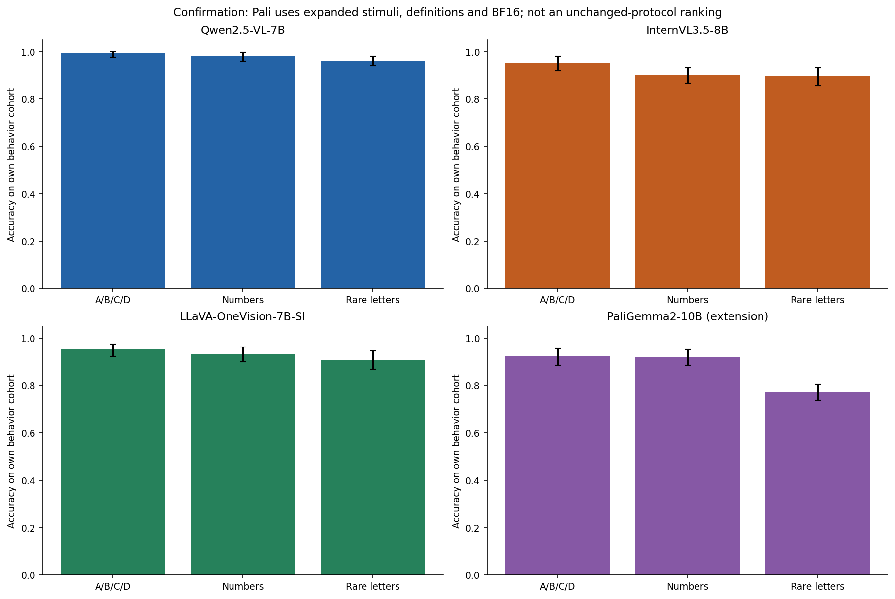
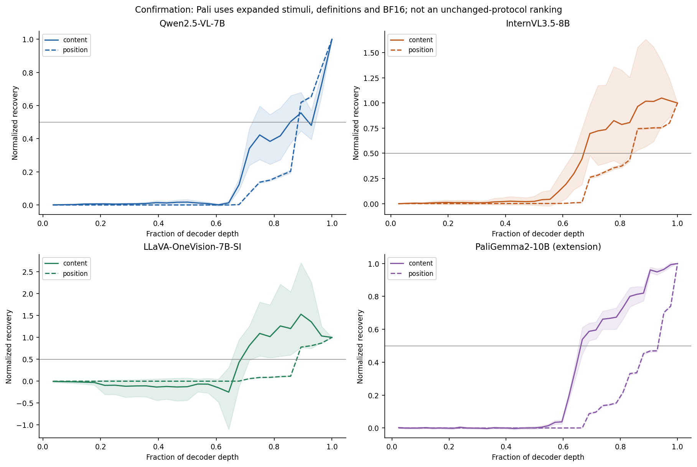
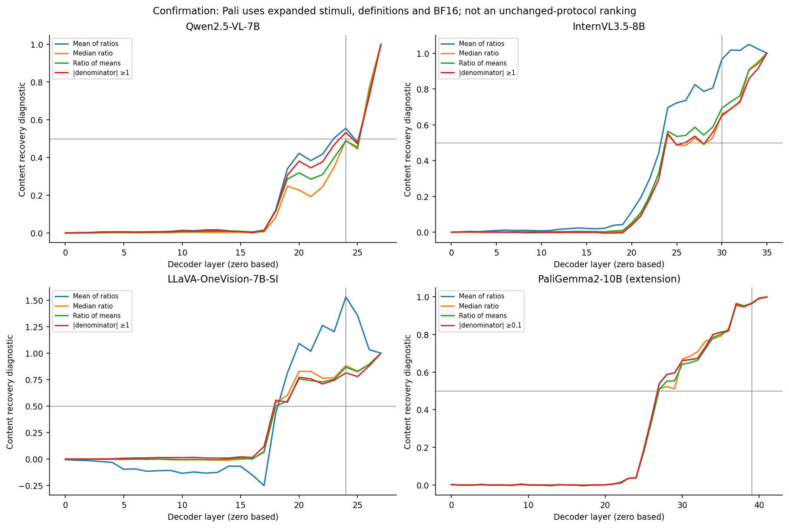
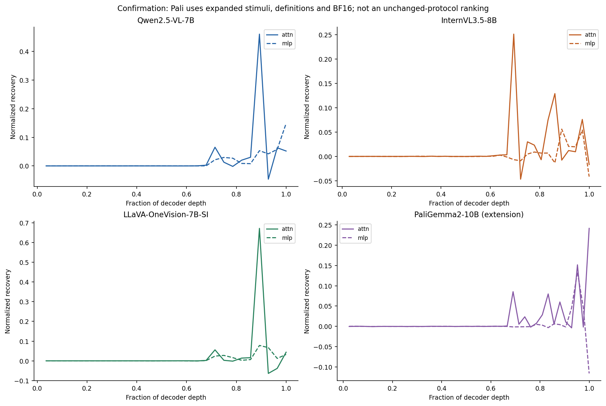
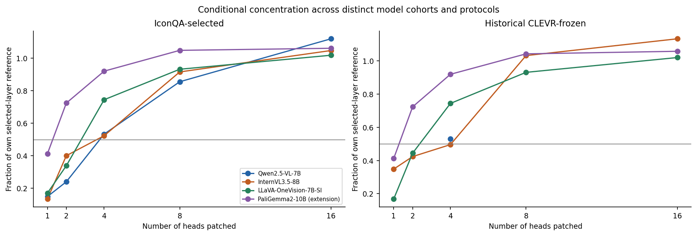
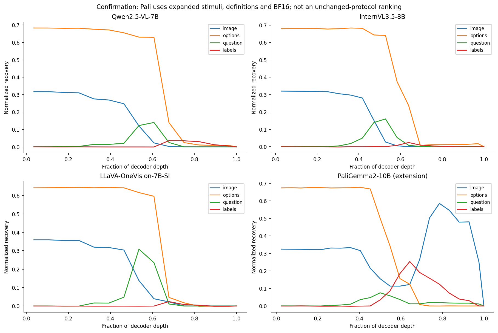
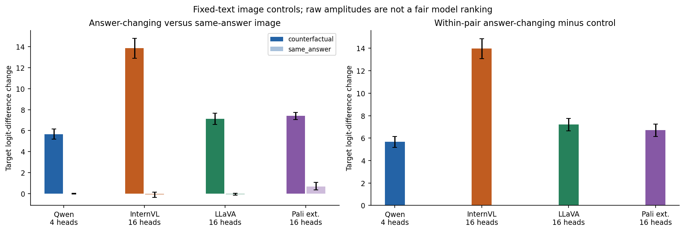

# IconQA Core-7: Qwen, InternVL, LLaVA and PaliGemma

**Combined scientific report — 30 October 2026**

This report examines how visual answer content becomes a displayed option
position and a requested answer symbol, and whether causal sites selected on
CLEVR transfer to IconQA. It integrates the completed PaliGemma2 analysis with
the controlled Qwen2.5-VL-7B, InternVL3.5-8B and LLaVA-OneVision-7B-SI studies.

**Comparison boundary:** Qwen, InternVL and LLaVA use the same CF-small release
and evaluated images. PaliGemma uses an **expanded release, a definition prompt,
BF16 execution and explicitly amended exploratory admission**. It is included
as a conditional mechanistic extension, not silently inserted into an unchanged-
protocol accuracy ranking. This distinction is part of the scientific result.

## Main findings

1. **Sparse attention contributions recur in all four executed conditions.**
   Newly selected four-head sets recover 53.26% / 52.27% / 74.39% / 91.93% of
   their selected-layer all-head references for Qwen / InternVL / LLaVA /
   PaliGemma. PaliGemma already exceeds half its reference with two heads
   (72.33%). These are conditional intervention effects, not shares of total
   model computation or proof of a complete circuit.
2. **Historical CLEVR sites remain useful.** The historical four-head sets pass
   the sparse criterion in Qwen, LLaVA and PaliGemma's extension. InternVL's
   historical top four remain well above matched random sets but narrowly miss
   the fraction cutoff: 49.56% against 50%. Its newly selected IconQA heads pass.
3. **A universal processing order is unsupported.** Content-readout transfer
   precedes position-readout transfer across examined normalization diagnostics
   in InternVL, LLaVA and PaliGemma's executed condition. Qwen's apparent order
   depends on phase and summary estimator; its exact order fails replication.
4. **Strong selected-pair mechanisms can coexist with weak representative
   behavior.** PaliGemma reaches 92.19% letter accuracy on its own cohort but
   still fails the original worst-position requirement at 82.81%, and its rare-
   letter score is 77.34%. Its compact head effect does not certify broad task
   competence or ordinary screen admission.
5. **Visual specificity is qualified, especially for PaliGemma.** Fixed-text
   answer-changing image donors shift answer margins more than same-answer
   appearance donors in every model. PaliGemma's same-answer effect is itself
   positive, however: +0.685 logits, with a source-pair interval above zero.
   The larger paired answer-changing gap remains +6.726 logits. This supports
   a selective contribution beyond the control, not a pure semantic-only code.
6. **Token-group sensitivity is not identical across conditions.** In the
   factorial test, the first three models' image-group effects peak at input,
   whereas PaliGemma's effect peaks later at L32. Its label-token patches also
   have a larger intermediate effect. Shared sparse attention findings therefore
   do not imply a shared complete visual-to-answer route.

The most defensible cross-model claim is **a recurring, localized attention
contribution to answer-position transfer and useful historical-site reuse under
specified conditions**. The evidence extends beyond the first three models'
Qwen-lineage language backbones through PaliGemma's Gemma backbone, but the
changed protocol prevents treating that extension as a clean architecture-only
replication.

## 1. Experimental scope and comparability

### Shared construction, different PaliGemma condition

All studies use marble-probability questions with four semantic alternatives:
certain, impossible, probable and unlikely. Each primary pair contains a native
image and an edited image in which one marble changes appearance at fixed
placement and total count. Auxiliary same-answer appearance edits provide a
control. Appearance replacement can include texture and shading; it is not a
strictly color-only intervention.

| Condition | Qwen / InternVL / LLaVA | PaliGemma extension |
|---|---|---|
|Dataset identity|`371ebbd9278cc3ba`|`1912e2c413c88764`|
|Release SHA prefix|`93efc68344571dda…`|`76c470e52cba1d55…`|
|Total source/edit pairs|136|211, adding 75 pairs|
|Calibration / discovery / confirmation pools|8 / 64 / 64 pairs|8 / 92 / 111 pairs|
|Representative behavior per phase|128 images, 64 source pairs|128 images, 64 source pairs sampled from larger pools|
|Eligible causal population per phase|32 pairs per model|32 pairs|
|Question condition|Original probability prompt|Frozen explicit category definitions|
|Precision|FP16|BF16|
|Global behavior admission|Original thresholds passed|Original failures reported descriptively under approved amendment|
|Seed|20261029|20261029|

The definition addition interprets the categories as all black, no black,
majority black and minority black. It was chosen using calibration evidence and
frozen before the completed exploratory run. The expanded pool maintains source
train/validation/test separation as calibration/discovery/confirmation. The
original small release and failed attempts are preserved.

The primary three-model behavior comparison is matched on the full evaluated
image population; PaliGemma's equal sample count does **not** imply identical
sample membership. All causal cohorts are conditioned on required clean answer
labels being correct, without filtering on intervention strength or desired
head effects. Repeated directions, positions, layers and head sets are not
independent examples.

### Execution and geometry

| Setting | Qwen | InternVL | LLaVA | PaliGemma extension |
|---|---|---|---|---|
|Model|Qwen2.5-VL-7B|InternVL3.5-8B|LLaVA-OneVision-Qwen2-7B-SI|PaliGemma2-10B-mix-448|
|Decoder layers × heads/layer|28 × 28|36 × 32|28 × 28|42 × 16|
|Batch|4|4|8|8|
|Hardware|2 RTX 2080 Ti|2 RTX 2080 Ti|1 A100 40 GB|1 A100 40 GB|
|Attention / precision|SDPA / FP16|SDPA / FP16|Efficient repeated-KV SDPA / FP16|Eager / BF16|
|Image tokens|256|256|3,699|1,024|
|Approximate total prompt tokens|322|312|3,752|1,109.33 mean|
|Scans for 32 discovery / confirmation pairs|32 / 33|39 / 39|38 / 41|68 / 64|

Native model processing is preserved. Differences in geometry, hardware, batch,
prompt and numerical conditions make runtime and raw intervention amplitudes
unsuitable as model-efficiency or architecture-quality rankings.

The LLaVA result is its completed A100 batch-8 campaign, not the separate Ada
batch-2 job `46918`. PaliGemma is the completed exploratory **v5** campaign,
not the stopped strict v4 attempt. No state change for another allocation is
inferred from these cloud results.

### How PaliGemma entered the exploratory study

The original unchanged prompt supplied only 2/64 eligible discovery pairs in
BF16; an FP16 diagnostic supplied 3/64. Switching selection precision would not
establish a valid BF16 causal cohort. Calibration-only definitions improved
correct checks from 49/80 to 71/80 and yielded 5/8 eligible calibration pairs.
The expanded screening then qualified 32 discovery pairs after 68 candidates,
but the representative behavior gate still failed.

An explicit user-approved v5 amendment made global behavior thresholds
descriptive while retaining 32 independent clean-correct pairs, calibration,
finite/numerical/memory checks, identity and data bindings, controls, exact work
counts and frozen discovery/confirmation separation. The new source and outputs
recomputed all methods; old checkpoints were not transplanted. **Completion
under this amendment is not a pass of the original scientific admission rule.**

## 2. Behavior: separate competence from selected-pair mechanisms

The table reports each run's own representative population. The first three
columns share the same images; the fourth has changed stimuli and prompt.

| Metric | Qwen | InternVL | LLaVA | PaliGemma extension: own cohort |
|---|---:|---:|---:|---:|
|Discovery A/B/C/D|97.66%|92.77%|93.36%|85.55%|
|Confirmation A/B/C/D|99.22%|95.12%|95.12%|92.19%|
|Confirmation numbers|98.05%|90.04%|93.36%|91.99%|
|Confirmation rare letters|96.09%|89.45%|90.82%|77.34%|
|Confirmation generated accuracy|99.22%|95.31%|93.75%|93.75%|
|Generated format compliance|100%|100%|100%|100%|
|Confirmation native A/B/C/D|100%|98.44%|100%|90.23%|
|Confirmation edited A/B/C/D|98.44%|91.80%|90.23%|94.14%|
|Class-balanced A/B/C/D|99.44%|95.77%|95.91%|88.26%|
|Strict four-position item consistency|99.22%|92.97%|89.06%|81.25%|



Equal-source-pair 95% intervals for confirmation letters are Qwen
97.66–100%, InternVL 91.80–98.05%, LLaVA 92.38–97.47%, and PaliGemma
88.48–95.51%. All newly harmonized intervals use 10,000 percentile-bootstrap
draws, NumPy seed 20261030. They are pointwise and exploratory, without
multiplicity correction. They quantify source-pair sampling under each observed
condition, not uncertainty from prompt, precision or batch changes. Perfect
observed native accuracy does not prove perfect population accuracy.

On the shared original behavior population, Qwen exceeds InternVL and LLaVA by
4.10 percentage points; paired intervals are 0.98–7.42 and 1.37–7.03 points,
respectively. InternVL and LLaVA have the same letter mean but each wins on
15 variants missed by the other. LLaVA performs better on number labels; the
models are not interchangeable merely because their letter averages coincide.

### PaliGemma's remaining failures

| Original admission condition | Discovery | Confirmation |
|---|---:|---:|
|Worst letter position >90%|77.34%, **fails**|82.81%, **fails**|
|Clean minus shuffled ≥30 points|83.01 points, passes|88.09 points, passes|
|Worst alphabet × position ≥45%|43.75%, **fails**|46.09%, passes|

PaliGemma's letter position accuracies in confirmation are 98.44%, 92.19%,
82.81% and 95.31%. Its rare-letter/position minimum is 46.09%. These failures
cannot be erased by the high average or by successful causal confirmation.

Its confirmation class accuracies are certain 100%, impossible 100%,
probable 58.82% and unlikely 94.23%. The class-balanced score falls to 88.26%,
revealing a major probable-category weakness that a 92.19% aggregate hides.
Discovery probable accuracy is only 40.63%. Unlike the other three runs,
PaliGemma's edited-image score exceeds its native score on this population;
there is no universal edited-image penalty. These are different class/sample
mixtures, so this reversal is not evidence that image edits improve reasoning.

### Common images do not remove all protocol differences

The synthesis verifies **identical processed image bytes and displayed
label/option mappings** on 47 discovery and 38 confirmation source pairs common
to all four evaluated behavior panels. The confirmation panel contains 304
letter variants: two images × four positions ×38 pairs.

| Letters on 38 common confirmation source pairs | Observed accuracy |
|---|---:|
|Qwen, original prompt / FP16|98.68%|
|InternVL, original prompt / FP16|96.05%|
|LLaVA, original prompt / FP16|96.38%|
|PaliGemma, definition prompt / BF16|88.82%|

This is a useful **common-image, different-condition diagnostic**, not a pure
model comparison. Prompt semantics and numerical execution still differ.
No paired PaliGemma superiority/inferiority significance claim is made.

Causal selection differs more strongly: only 12 confirmation pairs are eligible
in all four models. PaliGemma overlaps 12 withQwen,15 withInternVL and 15 withLLaVA;
the original three have 23 pairs in common. A fully matched four-model causal
comparison is not established by giving each run 32 pairs.

## 3. M1/M5: transferable content and position readouts

The residual intervention replaces the final-prompt-token state with a donor's
state at a specified layer. Position contrasts preserve answer content while
moving its displayed position and use answer-label differences. Content
contrasts keep the output symbol fixed while changing the answer and use
semantic-word token differences. Factorial contrasts vary both and record
donor-content/donor-position/recipient/other label outcomes. These readouts
measure different quantities.

Normalized recovery is `(patched difference − recipient difference) /
(donor difference − recipient difference)`. One matches the donor difference,
zero is no recovery, and negative values/overshoot are possible. It is not
accuracy or a proportion of all computation. The frozen transition is the
first mean recovery ≥0.5, with zero-based decoder layers.

| Frozen-analysis transitions | Qwen | InternVL | LLaVA | PaliGemma extension |
|---|---:|---:|---:|---:|
|Discovery content / position layer|24 / 24|24 / 30|18 / 24|28 / 39|
|Confirmation content / position layer|23 / 24|24 / 30|19 / 24|27 / 39|
|Exact relative order replicates?|No|Yes|Yes|Yes, under amended condition|
|Confirmation content / position normalized depth|85.71% / 89.29%|69.44% / 86.11%|71.43% / 89.29%|66.67% / 95.24%|

Depth is `(layer+1)/number of layers`. It enables a second descriptive view but
does not define an architecture-independent computation clock. PaliGemma's
twelve-layer content-to-position gap is not proof of a longer isolated circuit.



### Recovery normalization limits the ordering claim

| Confirmation content normalization,128 contrasts | Qwen | InternVL | LLaVA | PaliGemma extension |
|---|---:|---:|---:|---:|
|Negative denominator|0|6|8|0|
|Absolute denominator <0.1|0|0|4|0|
|Absolute denominator <1|4|8|26|128|
|Minimum absolute denominator|0.8555|0.1719|0.02344|0.13452|
|Mean-of-ratios crossing|23|24|19|27|
|Median-ratio crossing|26|24|18|27|
|Ratio-of-mean-changes crossing|26|24|19|27|
|Crossing with absolute denominator≥1|24|24|18|**Undefined: no contrasts**|

Qwen's one-layer content lead is fragile: median and ratio-of-means cross after
position, while the stronger-denominator subset crosses at the same layer.
Its discovery alternatives also move from L24 to L26. Retain its original negative
exact-order replication; do not turn the confirmation mean into a robust
content-first claim.

InternVL and LLaVA retain content-before-position under the examined summaries.
LLaVA's large recovery peaks are nevertheless sensitive to small denominators:
its confirmation L24 mean is about 1.53, while median/ratio-of-means are about 0.88/0.87.

PaliGemma's median, ratio-of-means and original confirmation mean all cross L27,
before position L39. Every content denominator is below 1, so the common≥1 filter
is undefined and must not be reported as passed. Its detailed audit additionally
uses a transparent≥0.1 diagnostic, which crosses L27; in discovery this removes
6 small-denominator contrasts and crosses L27, versus the original mean's L28.
The unfiltered median/ratio agreement supports ordering without requiring that
model-specific filter. It does not establish precision-insensitive magnitudes.



All diagnostics leave selected pairs and frozen decisions unchanged. Correct
answer-label selection does not guarantee a strong semantic-word denominator.
The limited supported claim is earlier transfer of the **specified content
readout** in InternVL, LLaVA and PaliGemma's exploratory condition, with uncertain
ordering in Qwen. It is not a universal statement about when semantic information
first exists or when every form of position computation begins.

## 4. M2: attention versus MLP

| Confirmation position-transfer component | Qwen | InternVL | LLaVA | PaliGemma extension |
|---|---:|---:|---:|---:|
|Peak attention recovery / layer|0.4607 /24|0.2515 /24|0.6713 /24|0.2417 /41|
|Peak MLP recovery / layer|0.1484 /27|0.0561 /31|0.07813 /24|0.1342 /39|
|Attention dominance replicates?|Yes|Yes|Yes|Yes, conditional|

PaliGemma discovery attention/MLP peaks are 0.2407/0.1383. Its attention peak
is larger, but its relative MLP contribution is more substantial than the
LLaVA peak comparison suggests. Component effects need not sum to residual
recovery or jointly patched head effects.



The shared result is localized attention dominance on this answer-position
readout. It neither shows that MLPs are unnecessary nor provides an additive
accounting of total task computation. The same absolute L24 peak in the first
three models occurs at different fractional depths; PaliGemma's peak at L41 is
the final decoder layer of a 42-layer network.

## 5. M3: sparse sets and transfer of historical CLEVR heads

### Newly selected IconQA candidates

| Confirmation concentration | Qwen | InternVL | LLaVA | PaliGemma extension |
|---|---:|---:|---:|---:|
|Selected-layer all-head reference|0.7935|0.6923|0.8533|0.6790|
|Reference heads / whole-decoder heads|112 /784|128 /1152|112 /784|64 /672|
|Top-four recovery|0.4226|0.3619|0.6348|0.6243|
|Top-four fraction of own reference|53.26%|52.27%|74.39%|91.93%|
|Smallest tested prefix passing sparse criterion|4 heads|4 heads|4 heads|2 heads|
|Top-four matched-random empiricalp 95|0.05865|0.01185|0.01930|0.003232|
|Sparse verdict discovery → confirmation|sparse → sparse|sparse → sparse|sparse → sparse|sparse → sparse|

The criterion requires at most 4 heads to beat the empirical 95 thpercentile of
20 layer-matched random sets and recover≥50% of the **selected four-layer**
all-head effect. It is not a familywise significance test or a comparison with
all heads in the model. The all-head references use different layers and counts.

The new top-four sets are Qwen[L24H26,L26H24,L24H27,L26H26],
InternVL[L34H28,L30H5,L34H30,L24H31], LLaVA[L24H21,L24H26,L24H27,L24H24],
and PaliGemma[L41H10,L39H0,L34H12,L28H12]. Layer/head coordinates are within
each model; matching numbers across models do not establish head identity.

PaliGemma's top 2 recover 0.4911, or 72.33% of its 0.6790 reference. This meets the
sparse fraction criterion even though 0.4911 is below the separate 0.5 residual-
transfer threshold. Its top 4 recover 0.6243(pair-bootstrap 95% interval 0.613–0.636,
approximately); top 8/16 can exceed the all 64-head reference. Such overshoot
demonstrates nonadditive effects, not more than 100% of total model computation.



### Historical candidates: positive transfer with distinct negative evidence

| Historical four-head confirmation | Qwen | InternVL | LLaVA | PaliGemma extension |
|---|---:|---:|---:|---:|
|Recovery|0.4205|0.3716|0.6348|0.6243|
|Fraction of its own reference|52.99%|49.56%|74.39%|91.93%|
|Historical sparse criterion confirms?|Yes|**Borderline miss**|Yes|Yes, conditional|
|Top-four membership overlap with new set|3/4|1/4|4/4|4/4|

Qwen uses its corrected pair-balanced CLEVR freeze. InternVL's old top 4 still
beat random strongly, but their fraction falls from 50.96% discovery to 49.56%
confirmation. Larger historical sets remain effective. Its main confirmation
report checks the new IconQA set and therefore does not include this historical
set's negative sparsity verdict.

LLaVA's old and new top 4/8 memberships coincide, with early-order differences.
PaliGemma's first 4 historical candidates also coincide with the new ranking,
while larger prefixes differ slightly. Equal effects for identical sets on the
same cases are expected; they are not independent replications. Their usefulness
supports conditional reuse of sites selected on a different task, without proving
identical complete circuits or execution equivalence.

The original three-model shared-pair sensitivity preserves the broad head-effect
pattern on 23 commonconfirmation pairs. Only12 causal pairs are common after adding
PaliGemma, and actual selected members/layouts may differ. Four-model amplitudes
must remain conditional descriptions, not an architecture leaderboard.

## 6. Ablation: disruption under replacement by another clean example

The executed source and saved donor IDs establish **donor-resampling ablation**:
activations are replaced by those from another clean example with a different
correct symbol. This is neither zeroing nor replacement by a population mean.
The detailed LLaVA and PaliGemma narratives use “mean replacement”; this report
uses the executed definition and preserves those original reports unchanged.

| IconQA-set confirmation ablation,32 recipients | Qwen | InternVL | LLaVA | PaliGemma extension |
|---|---:|---:|---:|---:|
|Clean mean correct-label margin|6.8882|7.6655|3.7119|4.8887|
|Top-four mean margin drop|5.4575|5.5928|5.2671|7.2637|
|Accuracy remaining after top-four replacement|81.25%|84.38%|3.13%|0%|
|Accuracy remaining after all selected-layer heads|3.13%|3.13%|0%|0%|
|Accuracy remaining after saved random-four set|100%|100%|100%|100%|

PaliGemma's top 2 drop the margin by 5.3145 and leave 31.25% correct; top 4 drop
7.2637(95% source-pair interval 6.8105–7.6953), against random 4 drop 0.0039
(−0.0264 to 0.0352). These complement transfer results with substantial disruption.

Lower clean margins help explain why similar logit losses produce many more
errors in LLaVA than Qwen. Conflicting donor information, different recipients,
cohorts and logit scales prevent interpreting error drops as a universal
necessity ranking. Random ablation has one saved sampled set per k, unlike 20
random sets per k in patch-transfer validation. Resampling can inject a wrong
answer as well as remove useful information; exclusive necessity is unproven.

## 7. M6 and image controls: selectivity and its limits

### Token groups in factorial contrasts

At layer 0, content-and-position contrasts show image-group recovery around
0.317/0.320/0.359/0.324 and option-content recovery 0.683/0.680/0.641/0.674 for
Qwen/InternVL/LLaVA/PaliGemma. Input question/label-group effects are near zero.
All four conditions share this broad early pattern despite different visual geometry.



The full curves reveal a substantive difference beyond that input snapshot:

| Confirmation factorial group peak | Qwen | InternVL | LLaVA | PaliGemma extension |
|---|---:|---:|---:|---:|
|Image-group recovery / layer|0.3170 / L0|0.3201 / L0|0.3590 / L0|0.5854 / L32|
|Label-group recovery / layer|0.0356 / L18|0.0237 / L22|0.0240 / L18|0.2534 / L26|
|Question-group recovery / layer|0.1401 / L16|0.1597 / L18|0.3086 / L14|0.0748 / L20|

PaliGemma's later image-group peak has a pointwise pair interval of
0.5762–0.5946. It retains substantial susceptibility to donor image-state
replacement after the initial image contribution, while the first three models'
image-group curves decline. Its larger label-group and smaller question-group
peaks also differ from the matched three-model pattern. These measurements
suggest a different distribution of transferable information across token states
under the executed condition. Expanded stimuli, definitions, attention policy
and numerical execution differ together, so a uniquely Gemma-specific routing
mechanism cannot be inferred. The patches do not isolate individual edges.

These are not additive percentages of total computation. Question states can
acquire intermediate sensitivity, and late image-token effects can shrink
after visual information has propagated elsewhere. Neither result makes the
question or image globally unnecessary. PaliGemma's factorial donor-content
outcome peaks at L27 and the donor-position label becomes a majority at L39,
consistent with its readout-specific transition but not an isolated-edge proof.

### Fixed text, changed image donor

The recipient uses a native image. Donor forwards preserve displayed question,
labels and option ordering—including definitions where applicable—and change
only the image. Historical CLEVR heads are patched into the recipient. The
measurement is the change in edited-answer minus native-answer logit difference.

| Confirmation fixed-text control | Qwen | InternVL | LLaVA | PaliGemma extension |
|---|---:|---:|---:|---:|
|Historical heads patched|4|16|16|16|
|Answer-changing image shift|+5.6646|+13.8521|+7.1421|+7.4102|
|Same-answer image shift|−0.0010|−0.1182|−0.06445|**+0.68457**|
|Within-pair difference|+5.6655|+13.9702|+7.2065|+6.7256|
|Paired95% source-pair interval|5.1806–6.1606|13.0708–14.8638|6.6465–7.7451|6.1455–7.2617|
|Same-answer donor preserves native answer|32/32|32/32|32/32|31/32|



PaliGemma's same-answer effect is nonzero:95% interval 0.3408–1.0752 logits.
Discovery has the same direction, +0.3076 control versus+8.0234 answer-changing
shift. The counterfactual-specific paired gap remains much larger, but a purely
semantic interpretation is too strong. Appearance edits, model sensitivity to
them and occasional control-answer errors remain part of the result.

Every model's answer-changing clean donors depart from the native answer on
32/32 selectedpairs. The saved panel does not retain the complete patched four-
way argmax, so departure or a positive two-answer margin is not guaranteed
correct edited-answer replacement. These rates concern selected clean-correct
pairs, not the whole behavior population. Different head counts/scales and
PaliGemma's changed prompt prohibit ranking the raw shifts across models.

Late unrelated donors also transfer answer information through final-token
states. This limits position-specific or task-exclusive interpretations. Near-
unit recovery at the final layer is an overwrite/readout endpoint, not proof
of a special circuit. Identity controls preserve image and answer symbol while
permuting distractors; they are not exact-input no-op tests.

## 8. M4/M5/M7: format support, answer selection and numerical qualifications

All four conditions show increasing late support for answer-label tokens, but common
label elevation must be separated from the correct-versus-incorrect margin.
Lens stages index residual states: stage 0 is input and stageL+1 follows decoder
layerL. First positive mean letter-margin stages are 21/25/20/29 for
Qwen/InternVL/LLaVA/PaliGemma. These descriptive crossings lack a sustained-
crossing or confidence-bound rule and do not identify the first causal layer.

| Confirmation output diagnostic | Qwen | InternVL | LLaVA | PaliGemma extension |
|---|---:|---:|---:|---:|
|Full-vocabulary mass on letters|99.998%|approximately 100%|99.987%|86.60%|
|Full-vocabulary mass on numbers|91.29%|approximately 100%|96.67%|87.61%|
|Full-vocabulary mass on rare letters|91.00%|96.09%|94.64%|79.27%|
|Requested numbers among requested+default 8 symbols|94.24%|approximately 100%|98.15%|99.997%|
|Requested rare letters among 8 symbols|91.21%|96.09%|95.47%|99.910%|

PaliGemma strongly prefers the requested alphabet to defaultA/B/C/D within the
eight-symbol comparison, while much full-vocabulary mass remains outside its
four allowed labels and rare-letter accuracy is only 77.34%. M7 format preference,
valid-label mass and correct-answer selection are demonstrably different.
Its number prompts have a valid-label global argmax on 99.61% ofscored variants,
despite 100% format compliance on the separate 128-item generation panel.

Semantic-word and component projections are readout proxies, not complete
semantic representations. A word may decode weakly under a label-answer prompt
even when task behavior is correct. Vocabulary projections are affected by
normalization and are not additive; patching and ablation supply the conditional
causal evidence. A putative MLP-formatting/attention-selection decomposition
remains a hypothesis beyond the measured interventions.

### Numerical evidence does not erase historical batching failures

PaliGemma's originalBF16 larger-batch pilot changed some intervention label
predictions while remaining within logit tolerances. Fresh v5 train diagnostics,
structural calibration, six-cell replay and image-group/memory guards pass, but
the train sensitivity panel spans only 2 calibrationpairs/96 readouts. **Continuous
scientific metric equivalence between batch 1 and 8 remains unestablished.** This
is a qualification of inference, not an execution failure to hide or an issue
fixed by this synthesis.

Its final lens and saved behavior predictions agree across 3,072 clean prompts,
with maximum logit discrepancy 0.0625. That establishes final-projection
consistency on these inputs, not batch equivalence of every intervention.
LLaVA has one final-lens near-tie flip among 512 confirmationletterprompts,
maximum discrepancy 0.015625; its primary accuracy remains saved behavior 95.12%,
not final-lens 95.31%. No model result is inflated using a favorable projection.

## 9. Combined verdict and recommended claims

| Claim | Qwen | InternVL | LLaVA | PaliGemma extension |
|---|---|---|---|---|
|Ordinary global behavior admission|Passed|Passed|Passed|**Failed; amended exploratory continuation**|
|Attention dominance confirms|Yes|Yes|Yes|Yes, conditional|
|New sparse-head verdict confirms|Yes|Yes|Yes|Yes, conditional;2 heads suffice|
|Exact content/position order confirms|No|Yes|Yes|Yes, within changed condition|
|Earlier content transfer survives examined diagnostics|No|Yes|Yes|Yes;≥1 filter undefined|
|Historical four-head sparse criterion confirms|Yes|Borderline miss|Yes|Yes, conditional|
|Answer-changing shift exceeds same-answer control|Yes|Yes|Yes|Yes; control itself positive|
|Unchanged-protocol four-model ranking established|No|No|No|No|
|Complete causal circuit established|No|No|No|No|

**Recommended main claim:** Across three matched-release VLM studies and a
separately identified Gemma-backbone exploratory extension, small discovery-
frozen attention-head sets contribute substantially to answer-position transfer,
and historical CLEVR sites remain useful. Content/position timing differs by
model and readout; Qwen's ordering is sensitive, while the other executed
conditions show earlier content transfer under the examined summaries.

**Retain the negative evidence:** Qwen exact-order non-replication; historical
InternVL four-head cutoff miss; PaliGemma's failed original behavior admission,
class/position/symbol errors, nonzero appearance control and unestablished batch
metric equivalence; LLaVA's final-lens discrepancy. Positive integrity audits
and frozen confirmation flags do not convert these into positive findings.

The scope remains one marble-probability task template and two grade families,
nonuniform classes, assistant-reviewed appearance edits, baseline-correct causal
selection and a source pool with prior exposure. The original three share
Qwen-lineage language backbones; PaliGemma broadens backbone coverage under
changed conditions. Dataset, prompt, precision and admission differences prevent
architecture-only attribution. Useful causal sites and donor-replacement effects
do not identify isolated routing edges, exclusive necessity or general visual
reasoning mastery.

## 10. Evidence, reproducibility and supporting history

The [four-model evidence package](../consolidation/iconqa_four_model_analysis_20261030/README.md)
contains a compact summary, eight derived CSVs, seven comparison figures,
preserved LLaVA/PaliGemma audit qualifications, common-image diagnostics and
input/output hashes. Reproduce offline with:

```text
python scripts/local/synthesize_iconqa_four_model.py
```

The script verifies and reuses the immutable three-model package, then rehashes
the PaliGemma inputs used here and computes matching source-pair estimates.
It uses 10,000 bootstrap draws for new intervals, rather than mixing its source
audit's 2,000-drawintervals into the harmonized tables. Original frozen results
and reports are not rewritten. No model inference, intervention rerun, threshold
change or additional GPU experiment was performed.

PaliGemma's detailed saved-evidence audit has a **qualified pass:21,033 checks,
zero failures,595,648 rawJSONLrows,14 method checkpoints and 43 artifact hashes**.
Its portable export preserves 2,750 files, including prior failures and original
data. Reusing that audit is not a claim that every prior check was newly rerun.
Its source is manifest-bound; stale root “running” and generic “submitted-zip”
metadata are qualified by terminal receipts, complete phase files and source
hashes. Exact sampled random-head membership is not serialized per raw row,
which limits independent membership replay.

| Primary run | Stable provenance |
|---|---|
|Qwen|Ada46804; source`76939bed4367f109cd68b7c8b75db0dc527d99c8`; freeze`527e630191363241`|
|InternVL|Ada46912; source`724f9ca453abe3530845525b385bc1136447e52b`; freeze`2db911df9139622a`|
|LLaVA|A100 batch 8; source manifest`2729772181d2ed483f7ee2ce9f5f8924b36e965e46dc6a49cfbdeebd5440ecfa`; freeze`86b0a1875dad20a5`; [tracking run](https://wandb.ai/models-iiit-hyderabad5465/anlp-vlm-mcqa-staging/runs/5cd5124a1fff)|
|PaliGemma|A100 BF16 batch 8 exploratoryv 5; source manifest`fa73931758537ddb50b850b963e60f4383a9810610d110c3b551ab57a1333341`; freeze`b97ad8e1bcc25b81`; [tracking run](https://wandb.ai/models-iiit-hyderabad5465/anlp-vlm-mcqa-staging/runs/1f5d2091b5e7)|

The [three-model report](iconqa_core7_three_model_report_2026-10-30.md) preserves
the original matched comparison, fuller paired estimates and representation
figures. The [earlier Qwen/InternVL report](iconqa_core7_transfer_analysis_2026-10-30.md)
preserves all larger Qwen analyses: completed larger batch 4 is supporting
natural-image transfer evidence, while cancelled larger batch 1 is a numerical
stability check with incomplete confirmation. Neither is pooled into the primary
controlled comparison, and larger-versus-smaller is not a clean size ablation.

The full PaliGemma release identity is
`76c470e52cba1d55aa3af76baedf9cd402f495a49399f628dfbd68d0c2610cf8`; model
revision`b26d16fb4251090ba4a4aa5af9fca1f8248ed5b6`. Its completed 22:25 ISTexit0
campaign and qualified audit establish recoverable execution evidence, not a
claim about the current state of any GPU instance. Raw backups, model weights
and environments remain separate from the compact synthesis.
