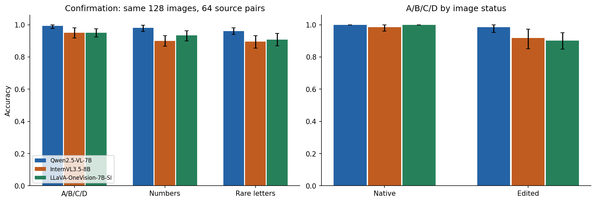
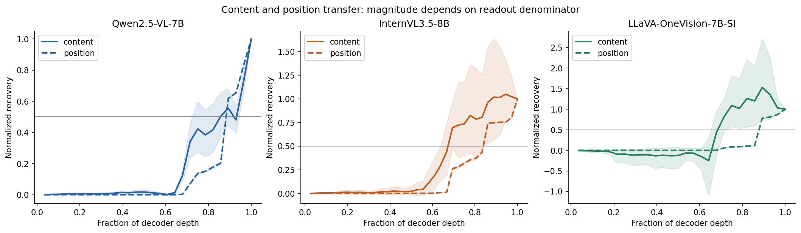
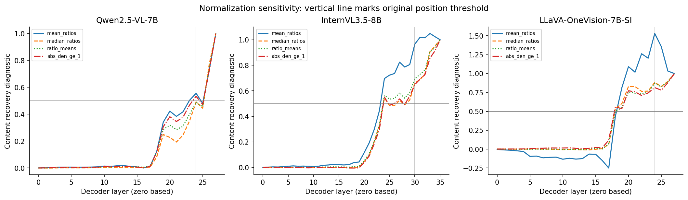
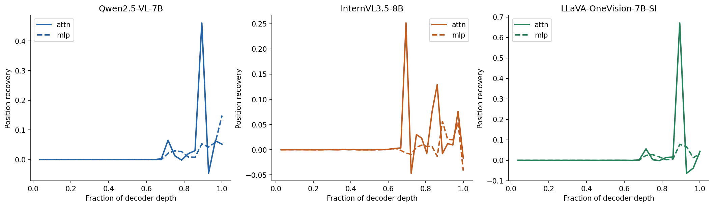
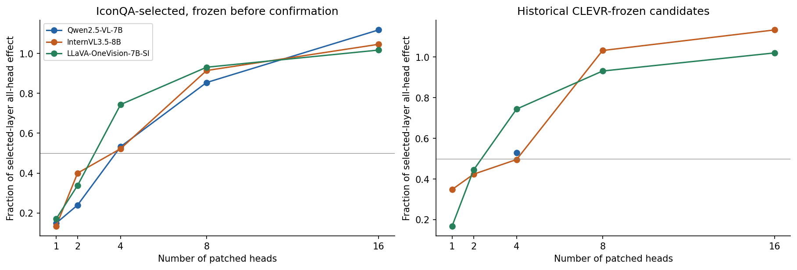
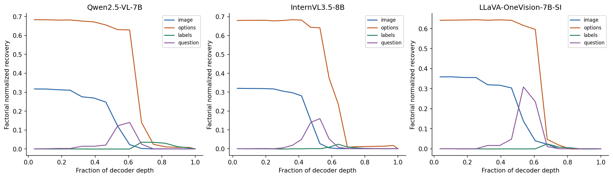
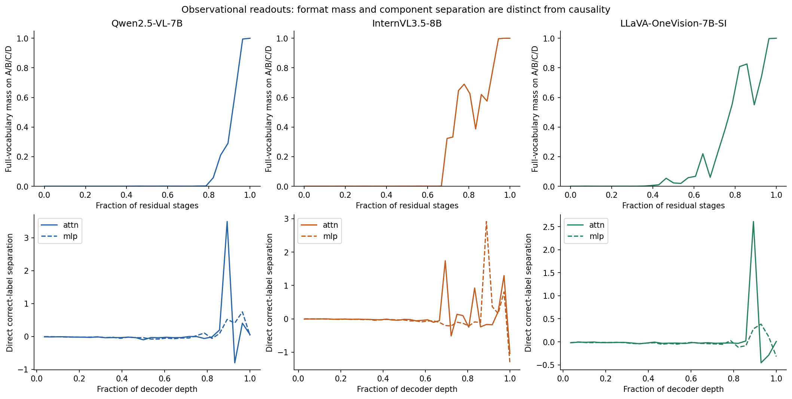

# IconQA Core-7: Qwen, InternVL and LLaVA

**Preserved matched three-model version.** The current combined report is
[Qwen, InternVL, LLaVA and PaliGemma](iconqa_core7_four_model_report_2026-10-30.md).
It adds PaliGemma as an explicitly different expanded/definition-prompt exploratory
condition; the unchanged-release comparisons below remain valid historical evidence.

**Combined scientific report — 30 October 2026**

This report asks how visual answer content becomes a displayed option position
and then a requested answer symbol, and whether causal sites selected on CLEVR
remain useful on IconQA. It combines the completed **controlled smaller-dataset**
experiments for Qwen2.5-VL-7B, InternVL3.5-8B and LLaVA-OneVision-7B-SI.
The earlier [Qwen/InternVL report](iconqa_core7_transfer_analysis_2026-10-30.md)
retains the larger Qwen runs and batch comparison as supporting evidence.
**PaliGemma is pending and is not included in the comparisons below.**

## Main findings

The clearest shared result is **attention-dominated answer-position transfer
through a small set of useful heads**, with conditional transfer of historical
CLEVR-selected sites to this controlled IconQA task. Four newly selected heads
recover **53.26%, 52.27% and 74.39%** of the selected-layer all-head effect in
Qwen, InternVL and LLaVA respectively. All three sets beat their matched random
references and retain the sparse classification in confirmation.

The shared result does not imply identical processing order. InternVL and LLaVA
show **content-readout transfer before position-readout transfer** in both phases,
and that ordering survives the normalization diagnostics examined here. Qwen's
exact ordering fails replication and changes under alternative content-recovery
summaries. A universal content-first sequence is therefore unsupported.

Qwen has the highest observed behavioral accuracy on the common confirmation
population: **99.22% A/B/C/D**, versus **95.12% for both InternVL and LLaVA**.
LLaVA and InternVL reach the same aggregate score with different errors,
position sensitivity and head-effect concentration. Behavioral success and
mechanistic organization must be reported separately.

Historical CLEVR heads transfer in all three models, but with different stability.
Qwen and LLaVA's historical four-head sets pass the sparse criterion in
confirmation. InternVL's historical top four remain well above matched random
sets but recover **49.56%** of their reference, narrowly missing the 50% cutoff.
This separate historical-set verdict must remain visible alongside InternVL's
successful newly selected IconQA-head replication.

Fixed-text image-donor controls add causal evidence: patches from answer-changing
edits shift the edited-versus-native answer margin much more than patches from
same-answer edits. Those tests use **4 / 16 / 16 historical heads** for
Qwen / InternVL / LLaVA; their raw effect sizes are not a fair model ranking.
The results identify useful causal sites under specified interventions, rather
than an exhaustive circuit, isolated routing edges or general IconQA competence.

## 1. What is comparable

### Shared task, release and sample units

All three primary runs use `ICONQA-CF-SMALL-20261029`, attempt2, with dataset
identity `371ebbd9278cc3ba`, seed **20261029** and the same image-aware release
hash `93efc68344571dda71999086df9b4638294220bce19901eb11998f519931c87c`.
The task is marble probability with four semantic answers: certain, probable,
impossible and unlikely. One marble's appearance changes at fixed placement and
total count. The native factual image, answer-changing edited image and auxiliary
same-answer appearance control allow stronger attribution than natural matched
pairs that differ in several uncontrolled ways.

The release allocates eight source pairs to calibration and 64 pairs each to
discovery and confirmation. Source train/validation/test membership maps to these
phases. Appearance replacement can alter shading and texture as well as category;
the intervention is not strictly color-only. Construction and assistant visual
review are documented in the [dataset report](iconqa_small_dataset_report_2026-10-29.md).

| Scientific population, per phase | Size and purpose |
|---|---|
|Behavior and lens|64 source pairs, 128 native/edited images; four positions and three alphabets|
|Clean behavioral predictions|512 variants per alphabet; 1,536 across three alphabets|
|Eligible causal population|32 source pairs per model, requiring all needed clean position variants correct|
|Residual / component / group cases|576 / 384 / 256 directed cases, followed across layers|
|Head cases|64 reciprocal cases from 32 pairs, using alternating native/edited members|
|Fixed-text image controls|32 selected pairs, one position per pair|

Repeated images, directions, prompt layouts, layers and head sets are not
independent examples. Behavioral comparisons below use the **same complete
128-image population**, while causal comparisons condition on model-specific
correctness and can use different source pairs.

### Selection overlap and execution differences

| Setting | Qwen | InternVL | LLaVA |
|---|---|---|---|
|Model|Qwen2.5-VL-7B|InternVL3.5-8B|LLaVA-OneVision-Qwen2-7B-SI|
|Decoder layers × heads/layer|28 × 28|36 × 32|28 × 28|
|Scientific batch|4|4|8|
|Execution|Two RTX 2080 Ti|Two RTX 2080 Ti|One A100 40 GB|
|Precision|FP16|FP16|FP16|
|Image tokens / total prompt tokens|256 / 322|256 / 312|3,699 / 3,752|
|Candidates scanned for 32 discovery / confirmation pairs|32 / 33|39 / 39|38 / 41|

Confirmation pair overlap is Qwen–InternVL **27**, Qwen–LLaVA **25**, and
InternVL–LLaVA **28**; **23 source pairs** are shared by all three. Discovery has
25 pairs shared by all three. Thus a shared release does not create perfectly
matched causal cohorts. Native model image processing is preserved, including
LLaVA's much longer visual sequence. Hardware, batch and image-token differences
also make wall time unsuitable for a model-efficiency ranking.

The LLaVA result here is the **completed A100 batch-8 campaign** with W&B run
`5cd5124a1fff`, not the separate Ada batch-2 job `46918`. Its detailed saved-evidence
audit is the source of the added LLaVA analysis. No result is inferred from the
status of the separate Ada run.

### Uncertainty and frozen decisions

This synthesis recomputes equal-source-pair summaries and **pointwise 95%
percentile bootstrap intervals using 10,000 draws and NumPy seed 20261030** for
all three models. This harmonizes intervals across the earlier Qwen/InternVL
analysis and LLaVA's original 2,000-draw audit. Small endpoint differences from
the detailed LLaVA report are expected; primary point estimates are unchanged.
Intervals are descriptive, with no familywise or multiple-comparison correction.
An observed perfect sample can produce a degenerate bootstrap interval and does
not establish perfect population accuracy.

Discovery-frozen choices and original confirmation flags remain unchanged.
Position transitions allow ±1 layer and content transitions ±2 layers; exact
relative ordering, component dominance and sparse classification are checked
separately. A passed transition tolerance is not the same as a replicated exact
ordering. Confirmation is baseline-conditioned held-out causal evidence, not a
pristine-source generalization claim.

## 2. Behavior: correctness, formatting and image dependence

### Same-stimulus performance

| Metric | Qwen discovery → confirmation | InternVL discovery → confirmation | LLaVA discovery → confirmation |
|---|---:|---:|---:|
|Forced A/B/C/D|97.66% → 99.22%|92.77% → 95.12%|93.36% → 95.12%|
|Forced numbers|97.27% → 98.05%|90.04% → 90.04%|92.19% → 93.36%|
|Forced rare letters|96.48% → 96.09%|89.65% → 89.45%|91.80% → 90.82%|
|Generated accuracy|97.66% → 99.22%|92.19% → 95.31%|93.75% → 93.75%|
|Generated format compliance|100% → 100%|100% → 100%|100% → 100%|

Confirmation A/B/C/D source-pair intervals are **97.66–100%** for Qwen,
**91.80–98.05%** for InternVL and **92.38–97.47%** for LLaVA. Forced-label accuracy
is distinct from generated-answer accuracy and valid-format generation. In
particular, LLaVA's primary confirmation score is **95.12% from saved behavior**,
not 95.31% from its final lens projection.



Paired comparisons use the same 64 behavioral source pairs:

| Confirmation A/B/C/D difference | Mean difference | Pointwise paired 95% interval |
|---|---:|---:|
|Qwen − InternVL|+4.10 percentage points|+0.98 to +7.42|
|Qwen − LLaVA|+4.10 points|+1.37 to +7.03|
|InternVL − LLaVA|0.00 points|−2.15 to +2.15|

Qwen's advantage is supported on this subset. InternVL and LLaVA are not
behaviorally interchangeable: each is correct on **15 confirmation letter
variants that the other misses**. These 30 discordant variants are dependent
layouts, not 30 independent samples. LLaVA exceeds InternVL on numbers by
3.32 points (paired interval 1.37–5.27), while its 1.37-point rare-letter
advantage has an interval spanning zero. These remain exploratory comparisons.

### Native versus edited images and semantic classes

| Confirmation A/B/C/D | Qwen | InternVL | LLaVA |
|---|---:|---:|---:|
|Native images|100%|98.44%|100%|
|Edited images|98.44%|91.80%|90.23%|
|Class-balanced mean|99.44%|95.77%|95.91%|
|Certain|100%|94.74%|100%|
|Probable|100%|100%|93.10%|
|Impossible|100%|100%|100%|
|Unlikely|97.78%|88.33%|90.56%|
|Strict four-position item consistency|99.22%|92.97%|89.06%|
|Worst alphabet × position cell|86.72%|78.13%|88.28%|

Qwen's remaining letter errors are edited unlikely cases. LLaVA's letter errors
are entirely on edited images and involve probable/ unlikely answers; InternVL
also makes native-image errors. LLaVA's lower strict item consistency despite
the same overall letter score as InternVL shows additional sensitivity to option
position. Its stronger worst-alphabet/position cell illustrates why one aggregate
robustness number cannot summarize all failure modes.

The class-balanced mean treats four semantic classes equally. It supplements the
ordinary score because the confirmation pool has 19 certain, 29 probable,
35 impossible and 45 unlikely images. It does not change the selected cohort.

### Image controls and full-vocabulary behavior

| Confirmation diagnostic | Qwen | InternVL | LLaVA |
|---|---:|---:|---:|
|Clean / blank A/B/C/D|99.22% / 35.16%|95.12% / 31.25%|95.12% / 27.34%|
|Different-answer shuffled-image accuracy|0.78%|1.76%|1.56%|
|Full-vocabulary mass on letters|99.998%|approximately 100%|99.987%|
|Mass on numbers|91.29%|approximately 100%|96.67%|
|Mass on rare letters|91.00%|96.09%|94.64%|

The clean-image advantage supports substantial image dependence. Shuffled images
are deliberately drawn from a different semantic-answer class, so their very low
accuracy is **not an unbiased 25% chance baseline**. Blank accuracy also reflects
the prompt and class distribution, not a universal chance level.

InternVL can concentrate more full-vocabulary probability on valid labels while
being less accurate than Qwen. Restricted four-way correctness, label mass and
valid-label argmax therefore answer different questions. Perfect compliance on
the sampled generation panel does not guarantee identical behavior across every
alphabet/position variant.

## 3. M1 and M5: content transfer versus position transfer

Residual-post activations are patched at the final prompt token. Position
contrasts hold the answer content fixed and change its displayed position;
their readout uses answer-label logit differences. Content contrasts keep the
answer symbol fixed and change answer content; their readout uses semantic-word
token logits. Factorial contrasts vary both content and position. These are
different readouts, not interchangeable measurements of a single quantity.

Normalized recovery is `(patched difference − recipient difference) /
(donor difference − recipient difference)`. Zero means no recovery on that
readout and one matches the donor difference. Overshoot, negative values and
small-denominator amplification are possible. Recovery is not accuracy or a
percentage of semantic computation.

| Frozen-analysis result | Qwen | InternVL | LLaVA |
|---|---:|---:|---:|
|Discovery content / position threshold layer|24 / 24|24 / 30|18 / 24|
|Confirmation content / position threshold layer|23 / 24|24 / 30|19 / 24|
|Confirmation relative order|content-first|content-first|content-first|
|Relative order replicates?|**No**, discovery was same-layer|Yes|Yes|
|Content / position depth in confirmation|85.71% / 89.29%|69.44% / 86.11%|71.43% / 89.29%|

Layer indices are **zero based**; normalized decoder depth is `(layer + 1)/L`.
LLaVA's content transfer occurs at a lower absolute layer than InternVL's, but
InternVL's deeper decoder gives a slightly earlier fractional-depth crossing.
Neither convention establishes a model-independent computation clock.



### Normalization sensitivity changes how strongly we can state the ordering

The LLaVA audit identified fragile content denominators. Applying the same
diagnostics to all three models reveals an important qualification for Qwen too:

| Confirmation content diagnostic, 128 unique contrasts | Qwen | InternVL | LLaVA |
|---|---:|---:|---:|
|Negative donor-minus-recipient denominator|0|6|8|
|Absolute denominator <0.1|0|0|4|
|Absolute denominator <1|4|8|26|
|Minimum absolute denominator|0.8555|0.1719|0.02344|
|Original mean-of-ratios first crossing|23|24|19|
|Median-of-ratios first crossing|26|24|18|
|Ratio of mean changes first crossing|26|24|19|
|Mean ratio restricted to absolute denominator ≥1|24|24|18|
|Original position crossing, for reference|24|30|24|

The diagnostics are additional estimands, not replacements for frozen decisions.
The denominator-filtered subset is a sensitivity analysis; it changes no saved
pair selection or original claim. Correct answer-label prediction does not
guarantee a large or positive semantic-word denominator.

**Qwen:** its one-layer confirmation content lead is not robust. The median and
ratio-of-means diagnostics cross after position, and the stronger-denominator
subset crosses at the same layer as position. Discovery's alternative content
crossings also move from L24 to L26. Preserve its original negative exact-order
replication and avoid a reliable content-first claim.

**InternVL:** all examined diagnostics cross at L24 in both phases, before
position at L30. Negative denominators affect some contrasts, but the examined
ordering is stable across these summaries.

**LLaVA:** examined content diagnostics cross at L18–19 in both phases, before
position at L24. This supports the ordering observation, while large recovery
peaks remain fragile: in the detailed audit, confirmation L24 mean recovery is
about 1.53, versus median/ratio-of-means around 0.88/0.87.



The defensible combined claim is **readout-specific earlier content transfer in
InternVL and LLaVA, with uncertain ordering in Qwen**. It does not mean all
semantic processing precedes every position computation, or identify the first
layer where information exists.

## 4. M2: attention and MLP contributions

| Confirmation position-transfer component | Qwen | InternVL | LLaVA |
|---|---:|---:|---:|
|Peak attention recovery / layer|0.4607 / L24|0.2515 / L24|0.6713 / L24|
|Peak MLP recovery / layer|0.1484 / L27|0.0561 / L31|0.07813 / L24|
|Attention dominance replicates?|Yes|Yes|Yes|

LLaVA's discovery peaks are attention 0.6716 and MLP 0.07625, both at L24.
Qwen and InternVL likewise retain attention-dominant position effects from
discovery to confirmation. All three have an attention peak at absolute L24,
although this is 89.29% of Qwen/LLaVA depth and 69.44% of InternVL depth.



This is a shared localization result under a particular final-token position
readout. Peak comparison does not show that MLPs are dispensable, or decompose
all task computation into additive attention and MLP percentages. Hardware,
input geometry, eligible cohorts and readout scales prohibit interpreting larger
peak amplitudes as better reasoning.

## 5. M3: sparse heads and historical CLEVR transfer

### Newly discovered IconQA sets, frozen before confirmation

| Confirmation head result | Qwen | InternVL | LLaVA |
|---|---:|---:|---:|
|Top-four recovery, pair-bootstrap 95% interval|0.4226 (0.4110–0.4348)|0.3619 (0.3511–0.3724)|0.6348 (0.6109–0.6583)|
|Matched-random-four empirical p95|0.05865|0.01185|0.01930|
|Selected-layer all-head recovery|0.7935|0.6923|0.8533|
|Top-four / selected-layer reference|53.26%|52.27%|74.39%|
|Reference head count|112|128|112|
|Whole-decoder head count, for distinction|784|1,152|784|
|Sparse verdict discovery → confirmation|sparse → sparse|sparse → sparse|sparse → sparse|

The sparse criterion requires at most four heads to beat the empirical p95 of
20 layer-matched random sets and recover at least half of the selected-layer
all-head effect. It is a descriptive comparator, not a familywise significance
test. The reference patches every head in four localized layers, **not every
head in the model**. Fraction estimates above 100% are possible because
multi-site effects are nonadditive and larger sets can include inhibitory heads.

The first four candidates, in frozen discovery order, are:

- **Qwen:** L24H26, L26H24, L24H27, L26H26.
- **InternVL:** L34H28, L30H5, L34H30, L24H31.
- **LLaVA:** L24H21, L24H26, L24H27, L24H24.

LLaVA concentrates all four in L24 and reaches 93.10% of its reference with eight
heads. This is stronger conditional concentration under this protocol than the
other models' top-four fractions; it is not an unconditional statement that
LLaVA has a simpler complete circuit or better behavior.



### Transfer of pre-frozen historical CLEVR sites

| Historical-set confirmation | Qwen | InternVL | LLaVA |
|---|---:|---:|---:|
|Top-four recovery|0.4205|0.3716|0.6348|
|Own selected-layer all-head fraction|52.99%|49.56%|74.39%|
|Random-four p95|0.05824|0.06245|0.01930|
|Historical four-head sparsity confirms?|Yes|**No**, borderline cutoff miss|Yes|
|Overlap of historical and new top-four identities|3/4|1/4|4/4|

Qwen uses its corrected historical CLEVR freeze `4f991401f5cb7239`. InternVL's
historical freeze is `84a69cc52774f28f`; its frozen top-four transfer remains
positive and far above random, but the fraction falls from 50.96% discovery to
49.56% confirmation. Larger historical sets transfer strongly, including
top eight at 103.19% of their reference. This is a narrowly missed categorical
sparsity result, not failure of all historical-site transfer.

LLaVA's historical top-four and top-eight memberships match the new IconQA sets,
with different early ordering. Equal top-four effects are therefore expected;
they are two analyses of the same set on the same cases, not independent
replications. Site identity is within each model: equal layer/head coordinates
across models do not establish neuron- or head-level functional equivalence.

### Does cohort overlap explain the concentration pattern?

Restricting to the 23 source pairs eligible in every model gives top-four mean
recovery **0.4169 Qwen**, **0.3612 InternVL** and **0.6367 LLaVA**, close to the
full selected-cohort means. This sensitivity suggests the observed pattern is
not solely due to which source pairs entered each cohort. However, native/edited
member selection and exact prompt layouts can still differ by model; this is
**shared-pair sensitivity, not exact-case matching or a controlled architecture
comparison**.

## 6. Ablation: disruption of the recipient's answer

The executed intervention replaces activations with those from a **different
clean example carrying a different correct symbol**. It is donor-resampling
ablation, not zero ablation or replacement by a population mean. The detailed
LLaVA narrative calls its plot “mean replacement”; the preserved executed code
and raw donor IDs establish the resampling definition used in this report.
The original detailed audit is preserved rather than silently rewritten.

| IconQA-head confirmation ablation, 32 recipients | Qwen | InternVL | LLaVA |
|---|---:|---:|---:|
|Clean correct-label mean margin|6.8882|7.6655|3.7119|
|Top-four mean margin drop|5.4575|5.5928|5.2671|
|Top-four drop, source-pair 95% interval|4.6587–6.1987|4.4268–6.7622|4.7231–5.8169|
|Accuracy remaining after top-four resampling|81.25%|84.38%|3.13%|
|Accuracy remaining after all selected-layer heads|3.13%|3.13%|0%|
|Accuracy remaining after saved random-four set|100%|100%|100%|

LLaVA's selected heads strongly disrupt its baseline-conditioned answers, but
its smaller clean margins help explain why a margin drop similar to Qwen's
produces many more errors. Differences in margin scale, donors, cohorts and
geometry prevent a direct universal necessity ranking. Random ablation retains
one sampled set per k, unlike 20 sets per k in patch-transfer validation.

The head sets carry a substantial causal contribution under this replacement
baseline. The findings do not establish exclusive necessity: resampling can
inject conflicting answer information as well as remove useful information.

## 7. M6 and fixed-text controls: what visual changes enter the answer pathway

### Token groups in content-and-position contrasts

| Confirmation L0 group recovery | Qwen | InternVL | LLaVA |
|---|---:|---:|---:|
|Image tokens|0.3170|0.3201|0.3590|
|Option-content tokens|0.6829|0.6800|0.6412|
|Option-label tokens|approximately zero|approximately zero|approximately zero|
|Question tokens|approximately zero|approximately zero|approximately zero|

These factorial contrasts change image answer content and option position/order
together. Image and option-content patches both contribute early under this
readout, with question/label-token patches near zero at L0. The pattern is shared
across all three models, despite their different visual-sequence lengths.
The groups are not additive independent contributions, and this table is not a
causal attribution of 32% versus 68% of total model computation.

Question-token sensitivity becomes positive at intermediate layers, peaking at
0.1401 (Qwen L16), 0.1597 (InternVL L18) and 0.3086 (LLaVA L14). This is consistent
with information becoming available through contextual question states after
early visual/option processing, but does not isolate a particular routing edge.
Near-zero sensitivity at input is not evidence that the question is irrelevant.

In the final-token factorial outcomes, the donor-position label first becomes
a majority at L24 / L30 / L24 for Qwen / InternVL / LLaVA; the donor-content
outcome peaks at L21 / L27 / L21. These categorical outcomes provide a separate
description of the transition. They are not semantic-word normalized recovery,
and must not be substituted for the content-threshold analysis above.



Late image-token patches can be small after visual information has already
propagated into later states; that does not make the image globally unnecessary.
Content-only token-group magnitudes inherit semantic-readout denominator
sensitivity. The fixed-text control below isolates image-donor changes more
directly than factorial option-order changes.

### Same displayed text, different donor image

The recipient uses the native image. Donor forwards preserve the displayed
question, option contents, labels and order; only the image changes. Historical
CLEVR heads are patched into the recipient. The outcome is the change in
edited-answer minus native-answer logit difference.

| Confirmation fixed-text head panel | Qwen | InternVL | LLaVA |
|---|---:|---:|---:|
|Historical heads patched|4|16|16|
|Answer-changing image patch shift|+5.6646|+13.8521|+7.1421|
|Same-answer image patch shift|−0.0010|−0.1182|−0.06445|
|Paired answer-changing minus same-answer shift|+5.6655|+13.9702|+7.2065|
|Paired 95% source-pair interval|5.1806–6.1606|13.0708–14.8638|6.6465–7.7451|

All three paired contrasts are substantially positive. On these selected pairs,
same-answer clean donors preserve the native answer in 100% of cases, whereas
answer-changing donors depart from it in 100%. These behavioral checks are
conditional on selected clean-correct examples and do not imply perfect
performance over every edited image.

The saved panel retains two-answer differences and departure from the native
answer, not the complete patched four-way prediction. Do not report these rates
as guaranteed correct edited-answer replacement. Different head counts and
model logit scales also prevent comparing raw shifts as a quality ranking.

### Limits from unrelated donors and identity controls

Unrelated examples can transfer their answer symbols through late final-token
states, so the localized pathway is not necessarily a position-specific or
task-exclusive code. Near-unit recovery at the final layer is an overwrite
endpoint, not evidence of a specialized circuit. Identity controls preserve the
image and correct symbol while permuting distractors; they are not exact-input
no-op interventions. These controls constrain the claim to useful causal sites.

## 8. M4, M5 and M7: readouts distinguish label formatting from selection

Lens stages are residual states: stage 0 is input and stage L+1 follows decoder
layer L. They must not be equated with intervention layer indices. Across all
three models, answer-label vocabulary mass grows late, while correct-versus-
incorrect separation provides additional information about selection.

| Confirmation descriptive lens diagnostic | Qwen | InternVL | LLaVA |
|---|---:|---:|---:|
|First positive mean letter margin, stage|21|25|20|
|First positive mean number margin, stage|22|25|23|
|First positive mean rare-letter margin, stage|24|25|25|

These are first crossings of a descriptive mean, without a sustained-crossing
or lower-confidence-bound criterion. They show readability under a specified
output projection, not when information first exists or when computation becomes
causally necessary. Semantic readouts use answer-word token proxies rather than
complete semantic representations. Requested-versus-default alphabet mass in M7
is restricted to eight candidate symbols and is distinct from full-vocabulary
label mass.

| Final requested-alphabet mass among requested + default symbols | Qwen | InternVL | LLaVA |
|---|---:|---:|---:|
|Numbers versus default A/B/C/D|94.24%|approximately 100%|98.15%|
|Rare letters versus default A/B/C/D|91.21%|96.09%|95.47%|

This measures competition with default answer labels after renormalizing over
eight tokens. It excludes the rest of the vocabulary and does not measure
whether the selected label is correct. For example, LLaVA's 98.15% requested
number-set mass coexists with 93.36% number accuracy and 96.67% full-vocabulary
mass on that four-token set.

Semantic-word projections also depend on requested output format. LLaVA's final
mean semantic-content margin is negative under numbers (−2.176) and rare letters
(−1.414), despite high label accuracy and positive content-patching effects.
An answer-word token being poorly decoded in a label-answer prompt is not
evidence that semantic content is absent. This is another reason to treat the
M5 lens as a readout proxy and prioritize the controlled interventions.



Direct attention/MLP vocabulary projections separate common label elevation
from correct-label separation. Together with the causal patches, they are
consistent with a formatting contribution distinct from answer selection.
The projections themselves are observational, affected by normalization and
not additive. They cannot establish an MLP “formatting circuit” without a
targeted causal test.

The LLaVA detailed audit found a maximum final-lens versus saved-forward logit
difference of 0.015625 and one changed near-tied decision among 512 confirmation
letter prompts. Consequently, its final-lens accuracy is 95.31% while saved
behavior is 95.12%. The latter is used throughout this report. This numerical
qualification does not negate the calibrated causal results, but prevents an
inflated accuracy claim and rules out exact numerical equivalence of readouts.

## 9. Combined scientific verdict and claim boundaries

| Claim | Qwen | InternVL | LLaVA |
|---|---|---|---|
|Image-dependent behavior on the controlled subset|Supported|Supported|Supported|
|Attention-dominated position transfer replicates|Yes|Yes|Yes|
|New IconQA top-four sparse criterion replicates|Yes|Yes|Yes|
|Earlier content-readout transfer is stable across examined diagnostics|No|Yes|Yes|
|Original exact content/position order replicates|No|Yes|Yes|
|Historical CLEVR top-four sparse criterion confirms|Yes|Borderline miss|Yes|
|Fixed-text image donor gives answer-selective margin shift|Supported, 4 heads|Supported, 16 heads|Supported, 16 heads|
|Complete circuit / architecture-independent generalization|Not established|Not established|Not established|

**Recommended central result:** On a reduced controlled IconQA probability
subset, all three VLMs show attention-dominated answer-position transfer through
small, discovery-frozen head sets, with useful reuse of historical CLEVR sites.
InternVL and LLaVA have stable earlier content-readout transfer; Qwen's ordering
is sensitive to phase and normalization. Behavior, sparse concentration and
readout timing are related measurements rather than interchangeable evidence.

This is a reduced exploratory study on one task template and two grade families.
Class imbalance, assistant-reviewed appearance edits, potential edit cues,
baseline-correct causal selection and earlier Qwen source-pool exposure limit
generalization. Historical CLEVR used BF16 whereas these IconQA runs use FP16;
no cross-precision or cross-kernel equivalence is established. The models share
Qwen-lineage language backbones, so this is not replication across three
independent language-model families.

The evidence supports useful causal sites and conditional transfer, not a unique
ordered pipeline, an edge-complete circuit, general visual reasoning mastery or
an architecture ranking from intervention amplitudes. PaliGemma should be added
only when its own completed evidence and dataset comparability are checked.

## 10. Evidence, reproduction and supporting runs

The [combined evidence package](../consolidation/iconqa_three_model_analysis_20261030/README.md)
contains machine-readable summaries, eight derived CSV tables, seven comparison
figures, LLaVA audit/near-tie evidence and a SHA-256 input/output manifest.
Reproduce with:

```text
python scripts/local/synthesize_iconqa_three_model.py
```

The default LLaVA source is the sibling `ANLP-project-jarvis-pilots` worktree;
`--llava-root` selects another location containing its verified raw export and
detailed audit package. No model inference or original-result rewrite occurs.
Only the inputs used in this synthesis are rehashed; the prior full audits are
reused rather than claiming that all their checks were newly rerun.

| Primary run identity | Provenance |
|---|---|
|Qwen `ICONQA-46804`|Ada job46804, executed source `76939bed4367f109cd68b7c8b75db0dc527d99c8`; freeze `527e630191363241`|
|InternVL `ICONQA-46912`|Ada job46912, executed source `724f9ca453abe3530845525b385bc1136447e52b`; freeze `2db911df9139622a`|
|LLaVA `LLAVA-JARVIS-B8-20261030`|Cloud source manifest `2729772181d2ed483f7ee2ce9f5f8924b36e965e46dc6a49cfbdeebd5440ecfa`; freeze `86b0a1875dad20a5`; [W&B run](https://wandb.ai/models-iiit-hyderabad5465/anlp-vlm-mcqa-staging/runs/5cd5124a1fff)|

The detailed LLaVA audit records a **qualified pass: 17,581 checks, zero failures,
415,936 raw JSONL rows, 14 method checkpoints and 43 checkpoint artifact hashes**.
Its verified portable export has 1,112 files. Completion is established by
terminal queue receipts and complete phase manifests; stale root metadata saying
“running” is retained. Executed source is manifest-bound rather than asserted
to be a clean Git commit. Exact random-head membership is not serialized in
the saved per-row records, limiting replay of that part of the audit.

All primary phases have the required behavior, lens, patching, components,
heads, historical transfer and edit-control outputs. Qwen/LLaVA have 31,488
patching rows per phase; InternVL has 40,192 because it has more layers. These
are repeated intervention rows, not additional independent samples. Runtime,
backups and cloud sync establish execution/provenance rather than mechanism.

The **larger Qwen batch-4** result remains supporting natural-image transfer
evidence: historical four-head recovery 0.4153, 52.37% of its reference, with
all original main replication checks passing. **Cancelled larger batch-1** is
numerical batch-stability evidence only, with incomplete confirmation. Neither
is pooled into the three-model controlled comparison, and larger-versus-smaller
is not a clean dataset-size ablation because stimuli and protocol factors differ.
The previous report preserves those runs in detail.
