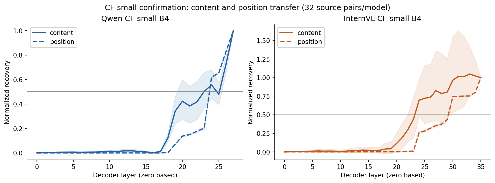
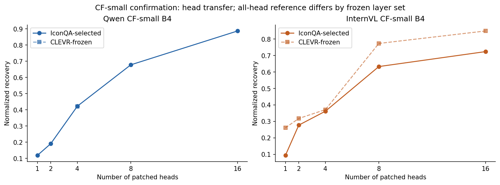
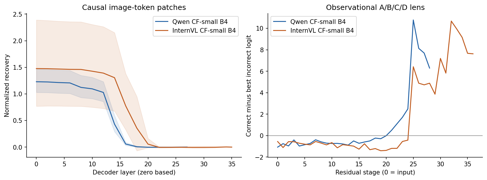

# IconQA Core-7 transfer: Qwen and InternVL

**Historical two-model version.** The current primary comparison is the
[combined Qwen/InternVL/LLaVA report](iconqa_core7_three_model_report_2026-10-30.md),
which adds the completed A100 LLaVA audit and cross-model normalization
sensitivity. This version is preserved for larger Qwen runs and the earlier audit.

**Evidence review: 30 October 2026.** This report covers Qwen2.5-VL-7B's original
batch-1, original batch-4 and controlled smaller-dataset batch-4 runs, plus
InternVL3.5-8B's controlled smaller-dataset batch-4 run. **The final comparison
between models uses only the controlled smaller dataset.** LLaVA and PaliGemma
are pending additions; their historical CLEVR results are not substituted here.

## Principal findings

1. **Original Qwen batch-4 reproduces batch-1 discovery and completes confirmation.**
   Batch-1 was intentionally cancelled, not a completed replication. Scientific
   discovery choices match, and numerical differences are small. Its preserved
   partial confirmation must not be pooled with batch-4 as an independent run.
2. **Small-dataset Qwen retains attention dominance and sparse useful heads.** Its
   A/B/C/D confirmation accuracy is **99.22%**. The corrected four CLEVR heads
   transfer with normalized recovery **0.4205**, beating matched random sets and
   recovering **52.99%** of their all-head reference. Exact discovery ordering
   does not replicate: content/position thresholds move from **24/24 to 23/24**.
3. **Small-dataset InternVL retains a clear content-before-position organization.**
   Its A/B/C/D confirmation accuracy is **95.12%**; content/position thresholds
   remain **24/30**. IconQA-selected four-head sparsity replicates. The historical
   CLEVR four-head set remains effective but narrowly misses its categorical
   sparsity criterion in confirmation: **49.56%**, against a 50% cutoff.
4. **The fixed-text image controls support visual-answer transfer through old
   CLEVR sites.** Answer-changing edits produce much larger target-margin shifts
   than same-answer edits. This supports useful causal sites, not a complete
   circuit or a pure position-only code. InternVL uses 16 frozen heads in this
   panel and Qwen uses four, preventing a direct effect-size ranking.

## 1. Run identity, completion and evidence

Live read-only Ada accounting was rechecked on 30 October. Times below are IST.
The saved [accounting receipt](../consolidation/iconqa_transfer_analysis_20261030/accounting_recheck_20261030.txt)
and the original backup inventories preserve terminal state independently of W&B.

| Job | Model / dataset / batch | Source | Node | Start → end | Elapsed | Outcome |
|---|---|---|---|---|---|---|
|45569|Qwen / natural pairs / 1|`75de070`|gnode052|29 Oct 03:17 → 29 Oct 21:22|18:05:25|User-cancelled; discovery complete, confirmation partial|
|45585|Qwen / natural pairs / 4|`fedffdd`|gnode052|29 Oct 03:28 → 30 Oct 03:02|23:33:53|COMPLETED, exit 0:0|
|46804|Qwen / CF-small / 4|`76939be`|gnode080|29 Oct 18:47 → 30 Oct 00:41|05:54:26|COMPLETED, exit 0:0|
|46912|InternVL / CF-small / 4|`724f9ca`|gnode053|29 Oct 21:07 → 30 Oct 05:29|08:22:09|COMPLETED, exit 0:0|

Each allocation used two RTX 2080 Ti GPUs and FP16. Allocation GPU-hours are
approximately 36.18, 47.13, 11.81 and 16.74 respectively, including startup and
non-inference overhead. They are not isolated hardware-performance benchmarks.

Durable backups are under `results/ada_completed_run_backups/job_<ID>/` in this
checkout. Remote result directories are:

- Original root `/home2/astroduck/projects/anlp-vlm-mcqa/iconqa_20261028/results/`:
  `full_checkpointed_wandb_75de070_attempt1` and `full_batch4_fedffdd_attempt1`.
- Small root `/home2/astroduck/projects/anlp-vlm-mcqa/iconqa_small_20261029/results/`:
  `qwen_small_b4_attempt1` and `internvl_small_b4_attempt1`.

The bounded offline audit reverified **984 / 1,027 / 1,087 / 1,127 inventory
entries** respectively, including shared assets at their referenced local paths.
It checked SHA-256, sizes, checkpoint artifact bindings, raw JSONL counts,
calibration receipts, numerical recovery formulas and small-run head means.
Both phases of all three completed runs have passing calibration receipts.
The inspected final stdout/stderr contain no matched traceback or OOM; W&B
connectivity/publication is a separate issue.

Saved W&B identities:
[45569](https://wandb.ai/models-iiit-hyderabad5465/anlp-vlm-mcqa-staging/runs/a9515ee713ef),
[45585](https://wandb.ai/models-iiit-hyderabad5465/anlp-vlm-mcqa-staging/runs/961e30dbe318),
[46804](https://wandb.ai/models-iiit-hyderabad5465/anlp-vlm-mcqa-staging/runs/65c84e3e96f8),
[46912](https://wandb.ai/models-iiit-hyderabad5465/anlp-vlm-mcqa-staging/runs/2047c80fa383).
These are provenance links; this report does not certify current cloud freshness
or artifact publication. Local evidence is sufficient for the reported analysis.

## 2. Protocol and interpretation

### Two datasets, two purposes

The original Qwen runs use native natural matched QA pairs, dataset
`be51cf308b2e35ae`, image-aware release
`894f82bce76c260b5a2563ac7ffea2d6f96982a5a3a1ad3fa3d25ad1e01caa31`, seed
**20261028**, and 64 eligible causal pairs per phase. These pairs do not isolate a
single controlled visual change. Their clean behavior evaluates 256 images per
phase. Use them for historical replication and batch stability.

The final comparison uses **ICONQA-CF-SMALL-20261029, attempt2**, dataset
`371ebbd9278cc3ba`, image-aware release
`93efc68344571dda71999086df9b4638294220bce19901eb11998f519931c87c`, seed
**20261029**. One marble changes category at fixed placement and total count;
the factual image is native. Same-answer edited controls accompany the primary
pairs. Construction details and exclusions are in the
[dataset report](iconqa_small_dataset_report_2026-10-29.md).

There are eight calibration source pairs, 64 discovery pairs and 64 confirmation
pairs. In each scientific phase:

- **Behavior:** all 64 source pairs, 128 images, four positions and three
  alphabets; 512 clean variants per alphabet. Native and edited images are
  reported separately. Generation/compliance use 128 items.
- **Causal sweeps:** 32 model-eligible source pairs, conditioned on all required
  clean position variants being correct. They yield 576 residual cases, 384
  component cases, 256 token-group cases and 64 head cases. Head cases use two
  reciprocal contrasts per pair, alternating native and edited members.
- **Fixed-text edit controls:** one position per eligible source pair, 32 pairs;
  displayed text/order is identical between native and edited image forwards.

Eligibility takes the first 32 passing pairs in a fixed hash order. Qwen scans
32/33 pairs in discovery/confirmation; InternVL scans 39/39. The two models share
**28/32 discovery pairs and 27/32 confirmation pairs**. Behavior compares the same
full population; causal effect magnitudes compare partly different eligible
cohorts. These are not fully matched causal model comparisons.

### What each metric measures

Normalized recovery is `(patched difference − recipient difference) /
(donor difference − recipient difference)`: zero means no recovery, one matches
the donor difference. It is a logit-difference ratio, not accuracy or a probability;
values above one and below zero are allowed. A residual transfer layer is the
first mean recovery ≥0.5. All decoder layer indices are **zero based**; lens
stages count residual states, with stage 0 at input and stage L+1 after layer L.

The main replication checks allow position transitions ±1 layer and content
transitions ±2 layers, but require identical content/position ordering, component
dominance and sparsity category. “Sparse” means a set of at most four heads beats
the empirical 95th percentile of 20 matched random sets and recovers at least
50% of the selected-layer all-head effect. This is not a corrected significance
test, and “distributed” is the protocol's threshold label.

New intervals in this package are descriptive 95% percentile bootstraps of
source-pair means (10,000 draws, seed 20261030). Saved head intervals use the
runner's pair-cluster bootstrap. Repeated layouts/contrasts are not independent
sample units. Perfect observed accuracy can yield a degenerate bootstrap
interval; it is not proof of perfect population accuracy. No multiple-comparison
correction or additional model run was performed.

## 3. Qwen: analysis of all three runs

### 3.1 Cancelled batch-1 versus completed original batch-4

Model checkpoint, dataset/release, random seed and selected causal pairs match.
All 20 Core-7 source modules in the preserved source snapshots are byte-identical.
Discovery and confirmation selection/eligibility files match exactly. Behavior,
lens and component-projection JSONL are byte-identical in both phases.

Discovery freezes have the same scientific fields after excluding source commit,
output path and freeze hash. Their distinct hashes (`dc934db1d957c6b6` and
`46c76268902cc9f5`) therefore identify provenance, not different scientific choices.

| Matched discovery quantity | Maximum absolute B1–B4 difference |
|---|---:|
|Attention recovery curve|0.00010230|
|MLP recovery curve|0.00008873|
|Content recovery curve|0.00052696|
|Position recovery curve|0.00009565|
|All-head mean recovery|0.00006034|

Measured discovery method times support the operational batch increase:

| Method | Batch 1 | Batch 4 | B1 time / B4 time |
|---|---:|---:|---:|
|Residual + token-group patching|6.77 h|5.44 h|1.25×|
|Components + ablation|5.23 h|4.17 h|1.25×|
|Head screen + validation|1.17 h|0.86 h|1.36×|

These are observed method timings under shared cluster conditions, not a
controlled speed benchmark or a claim of fourfold acceleration.

The final cancelled backup contains **43,721 of 89,600 expected confirmation
residual rows (48.80%)**, no confirmation token-group rows, and no completed
confirmation patching/components/heads checkpoints. Confirmation behavior/lens
are complete. The cancellation freed GPUs for LLaVA; outputs remain preserved.
**Decision:** retain batch-1 as matched numerical-stability evidence; use batch-4
as the complete original natural-pair result. Do not count the two as independent
replications, and do not infer a completed batch-1 confirmation.

### 3.2 Completed original batch-4

Both phases achieve 100% forced A/B/C/D accuracy and 100% generated accuracy on
their evaluated cohorts. Confirmation numbers/rare-letter accuracy is
99.61%/98.24%. Blank-image accuracy is 28.13%, and shuffled-image accuracy is 0%.
The clean-image advantage supports image dependence on this selected task.

| Mechanistic quantity | Discovery | Confirmation |
|---|---:|---:|
|Content / position transfer layer|24 / 24|24 / 24|
|Attention peak recovery / layer|0.4630 / 24|0.4629 / 24|
|MLP peak recovery / layer|0.1390 / 27|0.1418 / 27|
|IconQA top-4 head recovery|0.4193|0.4153|
|Top-4 / all-head effect|53.08%|52.37%|
|Sparse verdict|sparse|sparse|

All five categorical/transition replication checks and all top-k random-reference
checks pass. The natural-pair top-four set matches the corrected CLEVR set:
L24H26, L26H24, L24H27 and L24H21. The separate CLEVR-frozen arm has the same
top-four effect (confirmation 0.4153, saved 95% CI 0.4022–0.4291), against matched
random p95 0.04834. Agreement is positive transfer evidence, but does not repair
the natural pairs' visual confounds.

### 3.3 Completed smaller-dataset batch-4 — final-comparison Qwen result

Behavior accuracy is lower than on the original dataset, which contains a
different population. This difference cannot be attributed to batch size: both
completed runs use batch 4, and the dataset and causal sampling protocol changed.

| Behavior measure | Discovery | Confirmation |
|---|---:|---:|
|Forced A/B/C/D|97.66%|99.22%|
|Forced numbers|97.27%|98.05%|
|Forced rare letters|96.48%|96.09%|
|Generated accuracy / format compliance|97.66% / 100%|99.22% / 100%|
|Native A/B/C/D|100%|100%|
|Edited A/B/C/D|95.31%|98.44%|
|Class-balanced A/B/C/D|98.30%|99.44%|
|Blank / shuffled A/B/C/D|34.38% / 0%|35.16% / 0.78%|
|Worst alphabet × position cell|89.06%|86.72%|

All A/B/C/D errors are edited “unlikely” cases. Confirmation “unlikely” accuracy
is 97.78%; the other three classes are 100%. This is a narrow edited-image
weakness, not an across-class failure. The confirmation source-pair accuracy
interval is **97.66–100%**.

Discovery freeze `527e630191363241` selects content/position thresholds 24/24,
attention peak L24 and sparse heads. Confirmation thresholds are **23/24**;
attention peak is **0.4607 at L24**, versus MLP **0.1484 at L27**. Transition
tolerances, attention dominance and sparsity pass. **Exact order fails** because
confirmation is content-first rather than same-layer. The saved
`all_hypotheses_replicated=false` is a valid negative replication, not an execution
failure. The content curve at L23 is close to the 0.5 boundary and has a wide
pair-bootstrap interval, so this one-layer categorical shift is fragile.

The small-run top-four ranking is **L24H26, L26H24, L24H27, L26H26**. It overlaps
three of the four corrected CLEVR heads; the fourth is no longer L24H21.

| Qwen head arm, confirmation | Recovery (saved 95% CI) | Matched-random p95 | Fraction of own all-head reference |
|---|---:|---:|---:|
|IconQA-selected top 4|0.4226 (0.4109–0.4347)|0.05865|53.26%|
|Corrected CLEVR-frozen 4|0.4205 (0.4097–0.4320)|0.05824|52.99%|
|IconQA-selected top 8|0.6779 (0.6641–0.6925)|0.00913|85.43%|
|IconQA-selected top 16|0.8871 (0.8718–0.9007)|0.00173|111.79%|

The all-head reference patches every head in the selected four layers, not every
head in the whole model. The corrected CLEVR four-head set remains useful without
IconQA reselection. The top-16 ratio above 100% reflects nonlinear multi-site
patching; head effects are not additive shares of a conserved quantity.

## 4. InternVL: completed smaller-dataset batch-4

### Behavior and error structure

| Behavior measure | Discovery | Confirmation |
|---|---:|---:|
|Forced A/B/C/D|92.77%|95.12%|
|Forced numbers|90.04%|90.04%|
|Forced rare letters|89.65%|89.45%|
|Generated accuracy / format compliance|92.19% / 100%|95.31% / 100%|
|Native A/B/C/D|97.27%|98.44%|
|Edited A/B/C/D|88.28%|91.80%|
|Class-balanced A/B/C/D|93.21%|95.77%|
|Blank / shuffled A/B/C/D|30.47% / 0.98%|31.25% / 1.76%|
|Worst alphabet × position cell|79.69%|78.13%|

Confirmation errors concentrate in “unlikely” (88.33%) and “certain” (94.74%);
“probable” and “impossible” are 100%. Edited performance is 6.64 percentage points
below native performance. The confirmation source-pair accuracy interval is
**91.80–98.05%**. Numbers and rare letters introduce additional label/position
sensitivity despite perfect measured generation compliance.

### Localization, sparse heads and historical transfer

Discovery freeze `2db911df9139622a` retains content/position thresholds **24/30**
in confirmation. Thus content transfer precedes position transfer by six layers.
The confirmation attention peak is **0.2515 at L24**, versus MLP **0.0561 at L31**.
All five main replication checks and all top-k random-reference checks pass.
The causal factorial content-outcome peak moves L23→L27; it is distinct
from the stable causal 0.5 content-transfer threshold at L24.

The first four IconQA-selected heads are **L34H28, L30H5, L34H30, L24H31**.
They differ substantially from the historical CLEVR ranking, whose first four
are **L35H25, L24H31, L35H10, L24H30**. Useful transfer therefore does not mean
that the new task selects an identical ranking.

| InternVL head arm | Discovery recovery / own-all fraction | Confirmation recovery (saved 95% CI) / own-all fraction |
|---|---:|---:|
|IconQA-selected top 4|0.3629 / 52.50%|0.3619 (0.3514–0.3721) / 52.27%|
|CLEVR-frozen top 4|0.3857 / 50.96%|0.3716 (0.3557–0.3874) / 49.56%|
|CLEVR-frozen top 8|0.7837 / 103.53%|0.7736 (0.7496–0.7976) / 103.19%|
|CLEVR-frozen top 16|0.8567 / 113.18%|0.8494 (0.8352–0.8640) / 113.31%|

The CLEVR-frozen top-four confirmation effect beats matched-random p95 **0.06245**,
but misses the ≥50% fraction criterion by **0.44 percentage points**. Its
categorical verdict changes sparse→distributed. This is **borderline
non-replication of historical four-head sparsity**, alongside strong positive
transfer of the larger frozen sets. It is not evidence that CLEVR sites fail to
transfer. The main `confirmation_report.json` checks the IconQA-selected heads;
its “all hypotheses replicated” flag does not include this separate historical
transfer verdict.

## 5. What the controls add to the causal claim

### Fixed text: answer-changing versus same-answer image edits

The head panel patches donor activations into a native-image recipient, with
the displayed question, labels and option order fixed. The target logit
difference is edited-answer minus native-answer.

| Model / phase | Frozen historical heads | Answer-changing patch shift | Same-answer patch shift | Paired difference, 95% source-pair CI |
|---|---:|---:|---:|---:|
|Qwen discovery|4|+5.9722|+0.0156|+5.9565 (5.5054–6.3887)|
|Qwen confirmation|4|+5.6646|−0.0010|+5.6655 (5.1806–6.1606)|
|InternVL discovery|16|+14.7622|−0.1875|+14.9497 (13.9458–16.0225)|
|InternVL confirmation|16|+13.8521|−0.1182|+13.9702 (13.0708–14.8638)|

All 32 selected pairs per model/phase preserve the native answer under the
same-answer edit, and all answer-changing clean donors leave the native answer.
Those behavioral rates are conditional on selected clean-correct pairs, not
unconditional performance over the full dataset. InternVL's same-answer shift
is small relative to its answer-changing shift, but is not identically zero.

Qwen's mean patched target difference remains negative (−0.5928 in confirmation)
despite a substantial shift. A positive edited-versus-native two-answer margin
occurs in 11/32 Qwen and 31/32 InternVL confirmation cases. **These are not
four-way answer-flip rates:** the saved panel does not retain all four patched
logits/argmax. Claims of complete answer replacement would exceed the evidence.
Different head counts, logit scales and eligible cohorts also prohibit ranking
the models by the raw shifts in this table.

Resampling ablation provides a complementary disruption test. On 32 clean-correct
confirmation recipients per model, the IconQA top-four set drops the recipient
margin by **5.4575 (4.6587–6.1987)** for Qwen and **5.5928 (4.4268–6.7622)** for
InternVL; 81.25% and 84.38% remain correct, respectively. The saved `random4_0`
set leaves 100% correct in both models, while resampling every head in the four
selected layers leaves 3.13% correct. The historical CLEVR top-four sets also
drop margins (5.5234 Qwen; 5.8809 InternVL). These are in-distribution replacement
tests, not zero ablations or proof of exclusive necessity. Different sampled
donors across arms prevent direct ranking of their disruption strength.

### Image-token routing, unrelated donors and identity controls

Early image-token patches on content contrasts show strong recovery in both
models, declining toward zero at late image-token layers. At layer 0,
confirmation mean recovery is **1.2285 (1.0280–1.4642)** for Qwen and
**1.4760 (0.7680–2.3904)** for InternVL; at L24 it is approximately −0.0027 and
−0.0043 respectively. The wide InternVL interval and ratio overshoot warrant
caution. The pattern supports visual information entering through image states
and becoming available downstream, without identifying isolated routing edges.

Unrelated-donor final-token patches also transfer strongly. At Qwen L24 they
produce recovery **0.6611** and 92.19% donor-symbol flips; at InternVL L30 they
produce **0.7442** and 89.06% flips. Late residual states contain broadly
transplantable answer information. That limits a position-specific or
task-exclusive interpretation of final-token transfer. Near-unit recovery at
the final layer is an overwrite/readout endpoint, not proof of a specialized
circuit. Identity contrasts permute distractors while retaining image and answer
symbol; they are not exact-input no-op tests.

## 6. Core-7 coverage and readout limitations

| Method | Evidence available in this audit | Interpretation |
|---|---|---|
|M1 residual transfer|Every layer, five contrast types; frozen thresholds and confirmation|Late transferable content/position readouts; ordering caveat for small Qwen|
|M2 components|Attention/MLP patches and resampling ablations; direct/incremental vocabulary projections|Attention dominance on position contrasts; not a claim that MLPs are unnecessary|
|M3 heads|Discovery screen, frozen confirmation, 20 matched random sets, selected-layer all-head references, resampling ablation; separate old-CLEVR arm|Useful sparse sets; separate main sparsity from historical-set sparsity|
|M4 logit lens|All residual stages, all three alphabets|Observational readability, not causal onset|
|M5 content versus symbol|Semantic-token lens plus content/position factorial contrasts|First-token semantic proxy; not complete answer semantics|
|M6 token groups / outcomes|Image/question/options/labels patches and content-versus-position outcomes|Causal token-group evidence, without isolated-edge proof|
|M7 requested versus default alphabet|Numbers/rare letters versus A/B/C/D in saved lens rows|Eight-way restricted alphabet competition, not full-vocabulary probability|

The legacy aggregator searches `lens_behavior.jsonl` and
`component_projection_behavior.jsonl`, whereas these campaigns write
phase-suffixed files. Consequently its aggregate JSON does not expose the lens
curves even though the raw lens/projection records exist. This analysis reads
the actual phase-suffixed lens files into `lens_curves.csv`; the original run
outputs are unchanged. This is an export-discovery limitation, not missing
inference. Raw component-projection rows are counted and hash-verified; this
report does not add a full projection-mechanism analysis.

The first stage with positive mean requested-symbol margin is Qwen
**20/22/24** in discovery and **21/22/24** in confirmation for
letters/numbers/rare letters; InternVL is **25/25/25** in both phases.
These descriptive first crossings have no confidence-bound or sustained-crossing
criterion and are not the causal transfer layers. A common increase in all
candidate logits can indicate an output-format contribution; additional correct
symbol separation must be examined separately before assigning a mechanism.

In confirmation, Qwen's full-vocabulary mass on the requested four labels is
approximately **100% / 91.29% / 91.00%**, versus InternVL's
**100% / 100% / 96.09%**. The full-vocabulary top token is a valid requested
rare-letter label on **93.16% / 95.51%** of Qwen/InternVL variants, respectively.
Thus a high restricted four-way score does not guarantee valid-label generation.
Likewise InternVL's higher full-vocabulary label mass does not imply higher
correct-answer accuracy. M7's requested mass among eight symbols is another,
separately restricted diagnostic.

## 7. Final model-comparison table — smaller dataset only

Reporting roles: use the smaller run as the primary controlled experiment; retain
the completed larger Qwen batch-4 run as supporting natural-image transfer and
protocol-robustness evidence. Put larger batch-1 numerical agreement in the
appendix. Larger-versus-smaller is not a clean dataset-size ablation: pairing,
sampling, controls and stimulus construction changed together. Positive frozen
CLEVR-head transfer on natural images remains scientifically useful; it gives
less precise attribution to a specific visual change than the controlled edits.

Use confirmation as the primary comparison, with discovery retained for
replication. Normalized depth below is `(layer + 1) / number of layers`.

| Confirmation result | Qwen2.5-VL-7B | InternVL3.5-8B | LLaVA | PaliGemma |
|---|---:|---:|---|---|
|Dataset|CF-small `371ebbd9278cc3ba`|same|pending|pending|
|Behavior images / source pairs|128 / 64|128 / 64|pending|pending|
|Eligible causal source pairs|32|32|pending|pending|
|A/B/C/D accuracy|99.22%|95.12%|pending|pending|
|Native / edited A/B/C/D|100% / 98.44%|98.44% / 91.80%|pending|pending|
|Class-balanced A/B/C/D|99.44%|95.77%|pending|pending|
|Numbers / rare-letter accuracy|98.05% / 96.09%|90.04% / 89.45%|pending|pending|
|Content / position transfer layer|23 / 24 of 28|24 / 30 of 36|pending|pending|
|Content / position normalized depth|85.71% / 89.29%|69.44% / 86.11%|pending|pending|
|Order replicates?|No: same-layer→content-first|Yes: content-first|pending|pending|
|Attention / MLP peak recovery|0.4607 / 0.1484|0.2515 / 0.0561|pending|pending|
|IconQA top-4 recovery / all-head fraction|0.4226 / 53.26%|0.3619 / 52.27%|pending|pending|
|Historical CLEVR top-4 recovery / fraction|0.4205 / 52.99%|0.3716 / 49.56%|pending|pending|
|Main replication checks passed|4/5|5/5|pending|pending|
|Historical CLEVR four-head sparsity confirms?|Yes|No, borderline threshold miss|pending|pending|

On the **same full behavioral source pairs**, Qwen's A/B/C/D advantage is
**4.10 percentage points**, paired source-pair bootstrap 95% interval
**0.98–7.42 points**. This supports an advantage on this controlled subset; it
does not establish superiority across IconQA or VQA. Mechanistic amplitudes are
not a quality leaderboard, and causal cohorts overlap only partially.

When LLaVA and PaliGemma finish, add their smaller-dataset rows only after
verifying dataset hashes, exact stimulus/option population, calibration,
eligibility, head-freeze provenance, raw counts, controls and terminal accounting.
If a model uses an expanded or different smaller release, name that protocol
separately and compute a common-stimulus comparison before inserting a directly
comparable accuracy. Preserve model-specific head counts and precision policies.
Do not replace a negative replication with its execution-completion flag.

## 8. Evidence package and reproducibility

Analysis package:
[`consolidation/iconqa_transfer_analysis_20261030/`](../consolidation/iconqa_transfer_analysis_20261030/README.md).
Reproduce from this checkout with:

```text
python scripts/local/analyze_iconqa_transfer_runs.py
```

Inputs are the four immutable local backups, including inventory-mapped shared
assets. Published outputs include compact `results_summary.json`, source-pair
bootstrap behavior/causal tables, full lens curves, fixed-text paired contrasts,
figure PNGs and `publication_manifest.json`. The detailed `metrics.json`, original
analysis manifest and redundant SVG exports remain local and are reproducible.
Raw run artifacts are never rewritten.

| Raw records per phase | Qwen natural B4 | Qwen CF-small | InternVL CF-small |
|---|---:|---:|---:|
|Behavior / generated-compliance|5,120 / 256|2,560 / 128|2,560 / 128|
|Lens / component projection|89,088 / 172,032|44,544 / 86,016|56,832 / 110,592|
|Residual + token-group patches|151,040|31,488|40,192|
|Component patches / component ablation|114,688 / 7,168|21,504 / 1,792|27,648 / 2,304|
|Head validation / head ablation, main arm|11,712 / 1,408|7,808 / 352|7,808 / 352|
|Head screen, discovery only|10,752|7,168|8,192|
|Fixed-text edit-control source pairs|not run|32|32|

No non-finite normalized recovery, margin or patched-difference fields were
found in the audited top-level raw JSONL files. Small-run patch totals comprise
16,128+15,360 Qwen rows and 20,736+19,456 InternVL rows. Both phases retain their
method-boundary checkpoints. Existing run packages have no saved PNG figures;
the figures below were generated by this analysis and visually checked.







Limits remain: one marble-probability task template and two grade families,
imbalanced semantic classes, constructed edit cues and appearance changes beyond
color, assistant rather than independent human visual review, baseline-conditioned
causal selection, Qwen historical source exposure, shared Qwen-lineage language
backbones, and FP16 IconQA versus historical BF16 CLEVR execution. This bounded
audit supports the reported results; it is not independent human reannotation,
proof of pristine source holdout, cloud-publication verification or circuit
identification.
