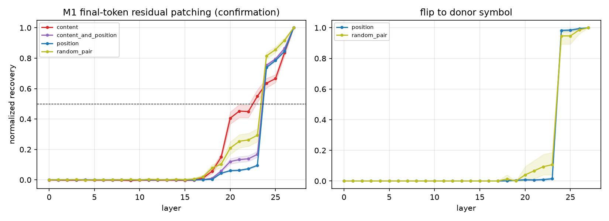
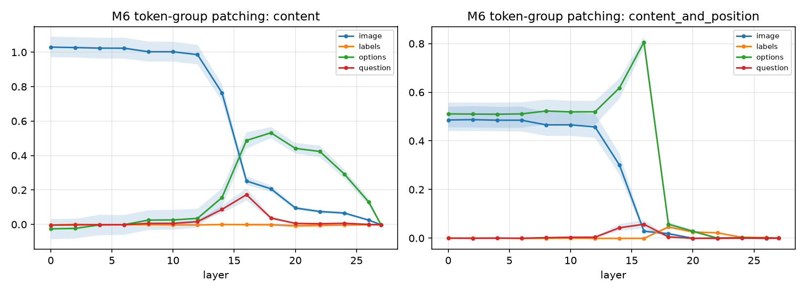
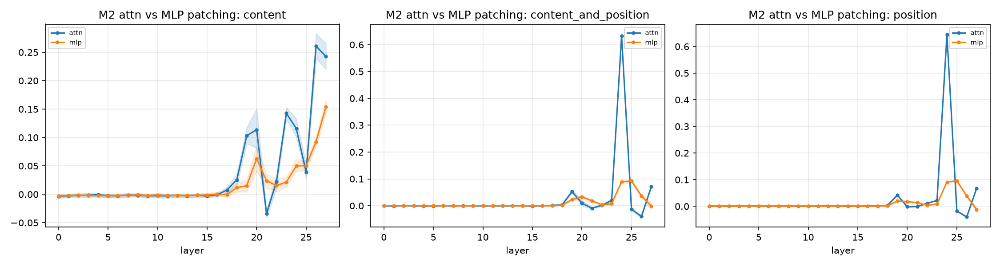
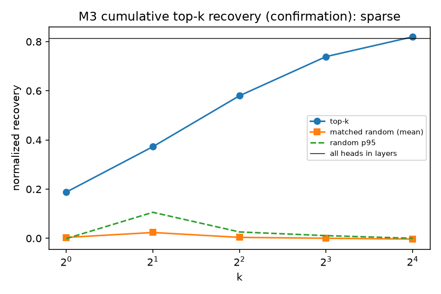
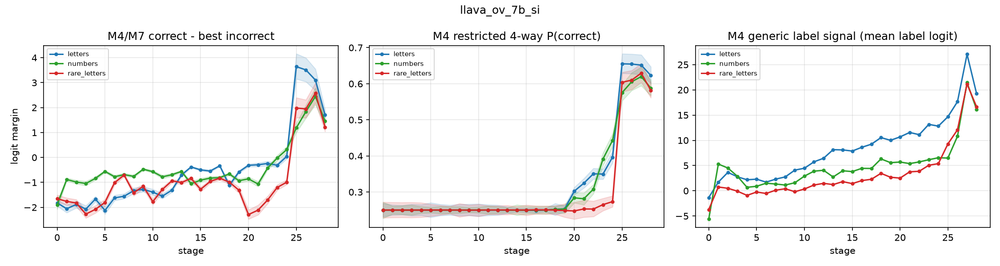

# LLaVA-OneVision-7B Core-7: completed-run report

Audited October 19, 2026. Experiment **E18-LLAVA-CORE7**, campaign
`20261016_124107`, completed October 17 at **22:53 IST**.

## Result in brief

The full discovery → freeze → held-out confirmation → confirmation audit →
plot workflow completed with **all five stage exit codes 0**. Both phases
passed all nine real-model calibration gates. Independent checks of raw
hashes, record counts, selected pairs, curves and head statistics passed.

LLaVA shows strong late answer transfer through attention, with a small frozen
head set retaining a large effect on held-out pairs. However, **the exact
content-versus-position ordering did not replicate**: discovery crosses the
transfer threshold at layer 24 for both; confirmation crosses at layer 23 for
content and 24 for position. Thus `execution_complete=true` and
`all_hypotheses_replicated=false` are both correct. This is a completed
experiment containing a negative replication result, not an execution failure.

## Provenance and experimental scope

| Field | Verified value |
| --- | --- |
| Checkpoint | `llava-hf/llava-onevision-qwen2-7b-si-hf` |
| Immutable revision | `cae7503dce88887557f73db1882328d21d9a7e21` |
| Actual parameters / language stack | 8,030,807,584; Qwen2, 28 layers, 28 heads/layer |
| Execution source | `051ea21e538497a8137f0cdf94f73543d3fbf063`, clean in both phase manifests |
| Dataset | CLEVR-MCQ-4 v3, `f5573e25f3aa2bf2` |
| Image-aware release | `eb7b79e56977bbaeed5fc981c5c8e09a4e26eaf8b1702283abe2d4bbfc718cbd` |
| Profile / seed | `full_core7`, seed 0, batch 4; scientific defaults unchanged |
| Behavior split | 256 items; all three alphabets evaluated |
| Discovery / confirmation interventions | 64 semantic pairs each, with disjoint pair IDs |
| M3 | 96 directed position contrasts across all 64 pairs per phase; 20 matched random sets/k |
| Execution | User-launched in `palirun` on pkgpu, physical GPU 0, RTX 5000 Ada 32 GB |
| Precision / attention | bfloat16, SDPA, single GPU; no quantization/offload |
| Runtime | Python 3.12.3, torch 2.5.1+cu121, transformers 4.57.6, accelerate 1.15.0 |
| Freeze | `e7b66bcb947ff29c`, selected on discovery before confirmation |

This was the **preselected LLaVA deep dive**, not a newly selected winner of a
full LLaVA-family screen. Behavior results below use 256 items; they are not
the 300-item screening result used for the PaliGemma family. The preceding
10B screen was reused with its original source identity and hashes; it was
not rerun by this LLaVA-only campaign.

## Behavior: image dependence, accuracy and response format

| Measure | Result |
| --- | ---: |
| A/B/C/D forced four-label accuracy | **65.33%** |
| Worst correct-option position | **60.55%** |
| Accuracy at positions A / B / C / D | 70.70 / 67.97 / 62.11 / 60.55% |
| Number-label accuracy | 63.57% |
| Rare-letter accuracy | 62.89% |
| Worst alphabet × position cell | 58.98% |
| Strict item consistency across letter permutations | 56.64% |
| Blank-image / shuffled-image accuracy | 28.03 / 26.86% |
| Clean minus shuffled | **38.48 percentage points** |
| Generated output compliance / generated accuracy | 100 / 64.84% |
| Global top token is a valid label: letters / numbers / rare | 100 / 91.50 / 99.90% |
| Full-vocabulary mass on four labels: letters / numbers / rare | 99.99 / 83.05 / 94.10% |

The image-control gap supports image dependence on this task, while perfect
output compliance does not imply correct reasoning. The weakest family is
`logic_or` (31.58%); `count_compare` reaches 97.37% and
`query_color_relate` 91.86%. This variability matters when interpreting a
single aggregate accuracy.

The behavior pass found **83 usable discovery pairs among the planned 160**;
the mechanistic profile used 64. Confirmation methods used a separate set of
64 pairs; that count is not an estimate of usable yield over all 128 planned
confirmation pairs. Mean image-token count was 1,836 and mean sequence length
1,881.25 on the clean behavior examples.

## Causal findings and held-out replication

Layer indices below are **zero-based**. Transfer is the first layer where mean
normalized recovery reaches the frozen threshold 0.5. It is not the same as
the first decodable layer, peak layer, or a probability of causal necessity.

| Frozen claim | Discovery | Confirmation | Outcome |
| --- | --- | --- | --- |
| Position-transfer layer | 24 | 24 | Replicated, tolerance ±1 |
| Content-transfer layer | 24 | 23 | Replicated, tolerance ±2 |
| Exact content/position order | Same layer | Content first | **Did not replicate** |
| Dominant component | Attention | Attention | Replicated |
| Head sparsity | Sparse | Sparse | Replicated |
| Top-k versus matched-random p95 | k=1,2,4,8,16 | All five pass | Replicated |

The layer tolerances permit modest localization shifts. The order check is
categorical and stricter: a one-layer shift can preserve content localization
while changing the exact ordering verdict. Do not rewrite discovery's
`same_layer` hypothesis as a confirmed content-first result.

### M1, M5 and M6: content, position and token groups

On confirmation, content recovery begins rising around layers 18–20, passes
0.5 at layer 23, while position recovery jumps from about 0.095 at layer 23
to **0.739 at layer 24**. Both are approximately 1 at the last layer.

The `random_pair` control also reaches **1.0001** at the final layer and
shows a late donor-symbol flip. Consequently, final-token transfer alone does
not establish a position-specific representation. Whole-residual replacement
can transfer a generic donor answer, including between unrelated pairs.

Token-group patches provide additional localization evidence. For content
contrasts, the strongest observed confirmation recovery for image tokens is
1.029 at layer 0; option-content tokens peak at 0.532 at layer 18, question
tokens at 0.173 at layer 16, and label-token patches remain near zero. The
content-and-position factorial separately has maximum content-following
fraction at layer 21 and first position-following majority at layer 24 in
both phases. No token-group size mismatch was recorded.

This pattern is consistent with visual evidence being useful earlier and late
answer-symbol transfer being attention dominated. It does **not** identify a
complete sequence of necessary edges. Group sizes differ, and normalized
recovery can exceed 1 or be negative; it is not an accuracy or a probability.

### M2: attention versus MLP

| Measure | Discovery | Confirmation |
| --- | ---: | ---: |
| Peak attention recovery, layer 24 | 0.6461 | **0.6439** |
| Peak MLP recovery, layer 25 | 0.09583 | **0.09565** |
| Layer-24 attention resampling-ablation margin drop | 5.6445 | **5.0176** |
| Layer-24 MLP resampling-ablation margin drop | 0.6250 | **0.5889** |

The attention/MLP peak comparison uses each component's own peak layer;
the ablation comparison uses the same layer. The convergent patching and
resampling-ablation results support attention dominance for this late answer
transfer, not a claim that MLPs are irrelevant elsewhere in the model.

### M3: frozen heads generalize to held-out pairs

Discovery selected layers `[19, 23, 24, 27]` and 16 candidate heads. The frozen
top four are **L24H27, L24H21, L24H26 and L24H24**. All-head recovery refers
to the 112 heads in those four selected layers, not every head in the model.

| k | Confirmation recovery | Pair-bootstrap 95% CI | Matched-random p95 | Fraction of selected-layer all-head effect |
| ---: | ---: | --- | ---: | ---: |
| 1 | 0.1879 | [0.1624, 0.2149] | −0.00123 | 23.09% |
| 2 | 0.3727 | [0.3437, 0.4025] | 0.10566 | 45.81% |
| 4 | **0.5799** | **[0.5561, 0.6017]** | **0.02575** | **71.28%** |
| 8 | 0.7392 | [0.7198, 0.7583] | 0.01080 | 90.86% |
| 16 | 0.8197 | [0.8049, 0.8326] | 0.00007 | 100.76% |

The all-head reference is 0.8135. A top-16 value slightly above that reference
is possible because intervention effects are not additive. The 96 directed
contrasts are distributed across **64 semantic pairs**; reported M3 means and
intervals use pair-level aggregation. The sparse rule (≤4 heads, above random
p95 and ≥50% of the all-head effect) holds in both phases. These are effects
of interventions on selected, correctly answered contrasts, not overall model
accuracy or proof that four heads form a minimal sufficient circuit.

### M4 and M7: readouts and arbitrary alphabets

Letters become readable at residual **stage 25** under the mean-margin plus
positive lower-confidence-bound rule. Stage 25 is the residual entering
layer 25, equivalently after layer 24; stages and patched layer indices must
not be conflated. A strong generic rise in candidate-label logits accompanies
correct-label separation. This decomposition is observational, not proof of
the cause or exact time at which computation occurs.

At the final stage, requested-versus-default label mass within the eight-label
comparison is approximately 0.835 for numbers and 0.945 for rare letters.
These are restricted eight-label diagnostics, distinct from the full-vocabulary
four-label masses in the behavior table. Content first-token margins provide
another observational readout, not a substitute for the factorial causal tests.

## Runtime, logs and completeness

| Stage | Discovery | Confirmation |
| --- | ---: | ---: |
| Behavior | 35m45s | Shared, not repeated |
| Lens / projections | 36m44s | Shared, not repeated |
| Residual + token-group patching | 8h07m57s | 8h15m52s |
| Components + resampling ablation | 6h36m30s | 6h43m10s |
| Heads + controls/ablation | 1h38m16s | 57m25s |
| Phase wall time | 17h51m07s | 15h59m25s |

Campaign wall time was approximately **34h12m**, including inter-stage logging,
freeze, final confirmation and plotting. It started October 16 at 12:41 IST;
confirmation completed October 17 at 22:48 IST and the full campaign at 22:53.
The earlier completion estimates were provisional; these measurements replace
them. The displayed M1 case counter excludes the following token-group sweep,
which explains why counter completion is not a safe phase checkpoint.

All five saved stage logs were checked for tracebacks, CUDA OOM, calibration
failure and launcher stops; none was found. Both calibration reports have
question/option/label span resolution 1.0 and content-token distinctness 1.0.
Their direct-projection additivity maximum error is 0.098, an informational
low-precision diagnostic, not a failed gate. There is no automatic mid-method
resume, but no recovery/restart was needed for this completed campaign.

| Raw artifact | Discovery rows | Confirmation rows |
| --- | ---: | ---: |
| Behavior / compliance | 7,680 / 256 | Shared |
| Lens / component projection | 89,088 / 172,032 | Shared |
| M1 + M6 patching | 126,228 | 129,604 |
| M2 component patching | 96,992 | 99,008 |
| M2 ablation | 7,168 | 7,168 |
| M3 single-head screening | 10,752 | Discovery only |
| M3 validation | 11,712 | 11,712 |
| M3 ablation | 1,408 | 1,408 |
| Figures / CSV tables | 10 / 7 | 6 / 5 |

Independent audit verified all 15 raw JSONL hashes against the execution
manifest, summary-derived counts, absence of duplicate patch/head-validation
keys, disjoint pair splits, original freeze hash, raw-derived transfer curves,
pair-weighted head means/random p95 and sparse verdict. All 16 PNGs decode;
the central M1, M3 and lens figures were also visually reviewed. The audit
does not establish generalization beyond this dataset or eliminate bias from
conditioning interventions on clean correctness.

## W&B and recoverable artifacts

All four cloud runs were read back as `finished`, authored by
`yashav-bhatnagar`, in `models-iiit-hyderabad5465/anlp-vlm-mcqa-staging`.
The user controls any later move to the intended team/project.

| Stage | W&B run | Summary keys | Result-artifact files |
| --- | --- | ---: | ---: |
| Discovery | [fvfd37ts](https://wandb.ai/models-iiit-hyderabad5465/anlp-vlm-mcqa-staging/runs/fvfd37ts) | 574 | 30 |
| Freeze | [ik9k54pi](https://wandb.ai/models-iiit-hyderabad5465/anlp-vlm-mcqa-staging/runs/ik9k54pi) | 11 | None by design |
| Confirmation | [2ie4ftiq](https://wandb.ai/models-iiit-hyderabad5465/anlp-vlm-mcqa-staging/runs/2ie4ftiq) | 502 | 21 |
| Confirm | [zudq2tcq](https://wandb.ai/models-iiit-hyderabad5465/anlp-vlm-mcqa-staging/runs/zudq2tcq) | 19 | None by design |

- Server originals: `/scratch/yashav/VLMCQA/results/pkgpu_continuation/20261016_124107/`.
- Server archive: `/scratch/yashav/VLMCQA/handoff/llava_core7_20261016_124107_audit_20261019.tar.gz`.
- Local full evidence mirror: `results/pkgpu_complete/llava_audit_20261019/`.
- Archive: **33,745,556 bytes**; SHA-256
  `607d076d52ab244d50503f6f0f1e1371c80eb6efabfa0b2b952684096d800d00`.
- [Compact curated evidence](../consolidation/core7_release_results/llava_ov_7b_si_core7/README.md)
  contains exact scientific values, summaries, tables, figures, audits and an
  export manifest. Machine paths are sanitized; stored freeze hashes refer
  to the original records. Raw outputs and logs remain in the verified mirror.
- Reproducible audit: `scripts/local/audit_llava_completed.py`; compact export:
  `scripts/local/export_llava_audit.py`; cloud read-back:
  `scripts/server/audit_core7_wandb.py`.

## Project implications and next steps

Full Core-7 is now complete for **Qwen2.5-VL-7B, InternVL3.5-8B and
LLaVA-OneVision-7B-SI**. LLaVA adds a stable sparse-head result and another
attention-dominated late answer-transfer result, but does not replicate a
single strict position/content order across discovery and confirmation.
All three still use Qwen-lineage language backbones, so this is not evidence
of universality across unrelated language-model architectures.

The PaliGemma family remains a completed **screening** result, not a completed
Core-7 result. PaliGemma2-10B was strongest of those three screened checkpoints;
none passed the frozen selection thresholds. No criteria were relaxed and no
Pali Core-7 run is implied by this LLaVA result.

Next work should distinguish a descriptive cross-model synthesis from new
causal experiments: compare the three audited full packages, retain Qwen's
corrected pair-balanced M3 and InternVL's sparsity non-replication, then design
path/edge tests and stronger random-donor controls if extending the mechanism
claim. Existing preliminary cross-model plots and submitted report/deck remain
historical artifacts; they were not silently overwritten by this audit.
